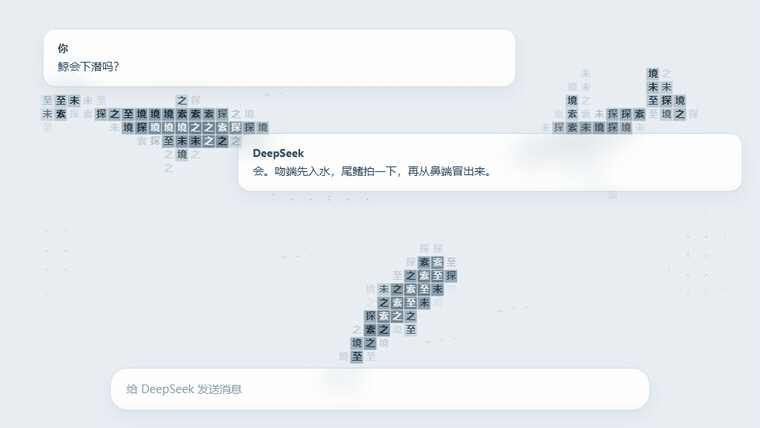
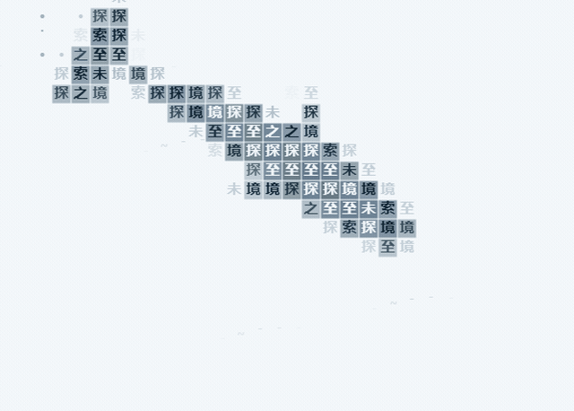
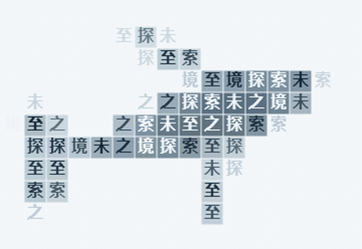

<p align="center">
  
</p>

<h1 align="center">Glyph whales</h1>

<p align="center">Turn your own text into whales that swim across DeepSeek Harness.</p>

<p align="center"><a href="./README.md">简体中文</a> · <strong>English</strong></p>

<p align="center">
  <a href="https://github.com/jryang1997/dsh-ascii-whales/releases/latest"></a>
</p>

<p align="center">
  <a href="https://github.com/jryang1997/dsh-ascii-whales/releases/latest">Download</a> ·
  <a href="#install">Install</a> · <a href="#settings">Settings</a> ·
  <a href="#local-preview">Local preview</a> · <a href="./CHANGELOG.md">Changelog</a>
</p>

> Inspired by [ascii-sharks](https://github.com/stackedlol/ascii-sharks). Thanks to the project for the original visual idea.

Five whale species cruise, turn, and glide through the conversation page, seen from directly above. Their bodies consist of your text or ASCII characters chosen by shading. Whales are drawn locally, without image assets or external services.

<p align="center">
  
</p>

<p align="center"><sub>Cruising on the conversation page. Opacity is higher than the default 0.6 so the motion is easier to see. The cards wear the content-box glass.</sub></p>

<p align="center">
  
</p>

<p align="center"><sub>Combine glyphs or colored cells with custom text or ASCII.</sub></p>

## Install

1. Download a `local-dsh-ascii-ocean-*.tgz` package from [Releases](https://github.com/jryang1997/dsh-ascii-whales/releases/latest).
2. Install the file through the DSH plugin manager.
3. Open **Plugins → Glyph whales**, adjust the settings, and select **Save**.

The current published package is [v0.14.0](https://github.com/jryang1997/dsh-ascii-whales/releases/tag/v0.14.0). Changes since 0.10.0 are in the [changelog](./CHANGELOG.md). The pictures below come from the real renderer, not a recording of the desktop window. The clips use a higher opacity than the default, and the fully hidden part of a dive is shortened.

## Features

- Form whales from Chinese characters, English text, or emoji. Leave the text blank to use the default phrase, `探索未至之境`.
- Choose blue, humpback, sperm, fin, or bowhead whales, or let a mixed group swim together.
- Draw glyphs alone for a lighter outline, or add colored cells to shade the back, flanks, flippers, and flukes.
- Adjust the count, body size, speed, opacity, and palette. Body size does not change swimming speed or tail-beat timing.
- Apply saved settings while preserving the group's movement. Switching models keeps the whales swimming.
- Version 0.14.0 adds sea-surface wind streaks and slow cloud shadows, each with its own switch. Whales leave through any edge and return on the opposite side, steering clear of obstacles there before they cross. See [atmosphere research](./ATMOSPHERE-RESEARCH.md).
- Each whale dives and comes back up on its own. The nose goes under first, the tail lifts and slaps, and the whale keeps its course while it is hidden. The nose returns first. The school does not dive together, and there is no separate dive switch. See the [changelog](./CHANGELOG.md).
- Follow light and dark themes and system preferences. Reduced motion shows a static pose. Hidden pages pause the animation, and the decorative layer lets pointer events pass through.

## Motion

<p align="center">
  
</p>

<p align="center"><sub>Dive and return. The nose goes under while the tail is still up. The fully hidden seconds are cut. The nose comes back first.</sub></p>

<p align="center">
  
</p>

<p align="center"><sub>A humpback fluke. Both lobes beat up and down together while the whale swims forward.</sub></p>

## Whales around your conversation

A frosted reading pane softens the whales behind the text column. Light and dark themes use their own glass materials.

| Light theme | Dark theme |
| :---: | :---: |
|  |  |

For the input box, you can show blurred whale silhouettes or have the whales swim around it.

| Option | Effect | Default |
| --- | --- | --- |
| Rounded glass pane | A continuous frosted pane behind the text column | On |
| Frosted input box | Whales appear as blurred silhouettes inside the input box | Off |
| Whales avoid the input box | Whales swim around the input box as an obstacle | Off |

**Frosted input box** and **Whales avoid the input box** are mutually exclusive. Enabling either turns the other off. The reading pane's glass is independent.

<details>
<summary>View input-box avoidance</summary>

<p></p>

</details>

<details>
<summary>Compare three whale sizes</summary>

<p></p>

</details>

Screenshots use the Chinese UI and come from the standalone preview or simulated environments. See [SOURCE-NOTES.md](./SOURCE-NOTES.md) for verification details and the limits of testing in the actual DSH desktop window.

## Settings

Dragging a slider updates the static sample in the settings page. Select **Save** to apply the draft to the conversation background. **Restore defaults** changes the draft; **Reload saved values** discards unsaved edits.

| Numeric setting | Range | Default |
| --- | --- | --- |
| Whale count | 1–8 | 3 |
| Swimming speed | 0.3–2 | 0.65 |
| Background opacity | 0.04–0.9 | 0.6 |
| Character size | 4–16 | 11 |
| Whale size | 0.55–1.55 | 1 |
| Glass strength | 0–1 | 0.55 |
| Browser left inset | 0–500 px | 280 px |

| Style setting | Choices |
| --- | --- |
| Whale species | Mixed group, blue, humpback, sperm, fin, or bowhead |
| Drawing style | Glyphs only, colored cells |
| Fill content | Custom text, ASCII characters |
| Ocean palette | Ocean, Azure, Indigo |
| Other switches | Show whales, Quieter reading area |

Custom text supports Chinese characters, English, emoji, and combined glyphs. Whitespace is ignored. The input limit is 40 UTF-16 code units, so some emoji use more than one unit. Switching to ASCII preserves your saved custom text.

The desktop app follows the sidebar width automatically. In a regular browser, adjust **Browser left inset** to position the visible whale area.

<details>
<summary>View the settings page</summary>

<p></p>

</details>

## Local preview

Download or clone the repository, then open [whale-preview.html](./whale-preview.html) in your browser. It uses the plugin's renderer and does not need a server.

The page includes all four rendering combinations and a live group of whales. Change the species, body text, size, speed, glass, and theme. A simulated input box at the bottom lets you compare frosted glass with avoidance.

## Development

<details>
<summary>Build, check, and package</summary>

Install dependencies from the project root, then run the commands you need:

```sh
npm install
npm run build
node preview.mjs
npm run check
npm test
node build.mjs --check
npm pack --ignore-scripts
```

`npm run build` generates `client.js` from source. `node preview.mjs` generates the standalone preview. The package name is `@local/dsh-ascii-ocean`, and the Host row id is `ascii-whale-background`.

| File | Purpose |
| --- | --- |
| [species.js](./species.js) | Body shapes and movement parameters for the five species |
| [model.js](./model.js) | Surfaces, projection, cell coverage, and configuration fingerprints |
| [motion.js](./motion.js) | Cruising, turning, gliding, and input-box avoidance |
| [rig.js](./rig.js) | Body turns and vertical tail strokes |
| [shading.js](./shading.js) | Raised-back and depth shading |
| [surface.js](./surface.js) | Character selection, palettes, and cell drawing |
| [glass.js](./glass.js) | Reading-pane and input-box geometry and materials |
| [engine.js](./engine.js) | Canvas drawing and updates in place |
| [settings.js](./settings.js) | Native DSH settings page |

</details>

## Documentation and references

The following reference documents are in Chinese:

- [Changelog](./CHANGELOG.md): version history and upgrade changes.
- [Implementation and verification notes](./SOURCE-NOTES.md): implementation details, root causes, and testing limits.
- [ASCII rendering research](./ASCII-RENDER-NOTES.md): cell rendering and character density.
- [Whale references](./WHALE-REFERENCES.md): overhead photographs used as species references.
- [Screenshot archive](./docs/archive): visual records of earlier versions.

Reference photographs, local verification evidence, and the third-party reference checkout are kept outside the published project. See [.gitignore](./.gitignore) for the directory rules.
