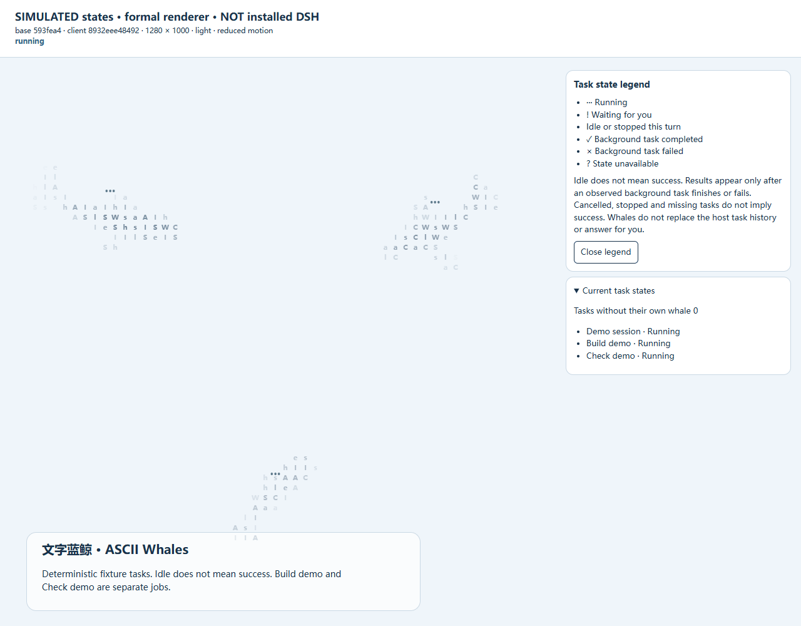
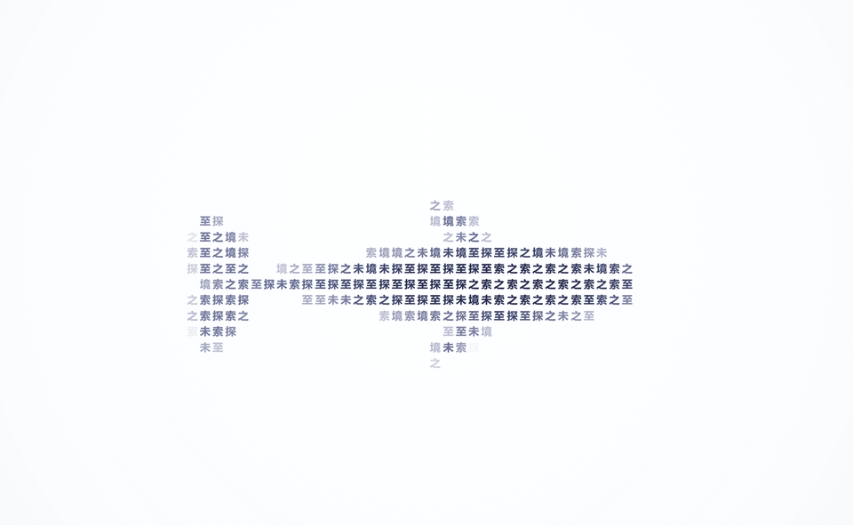
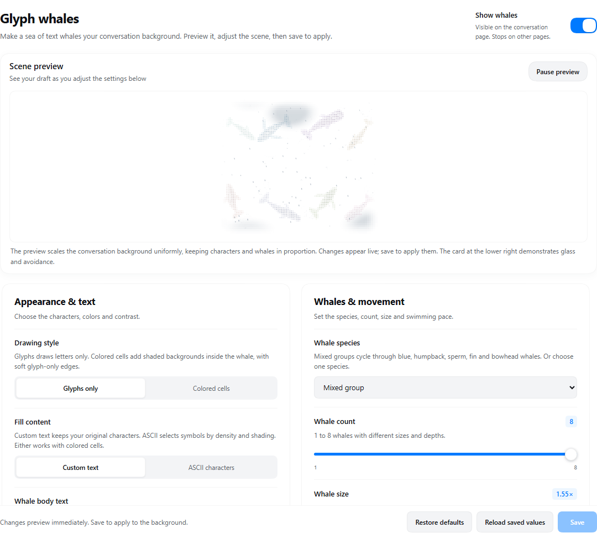
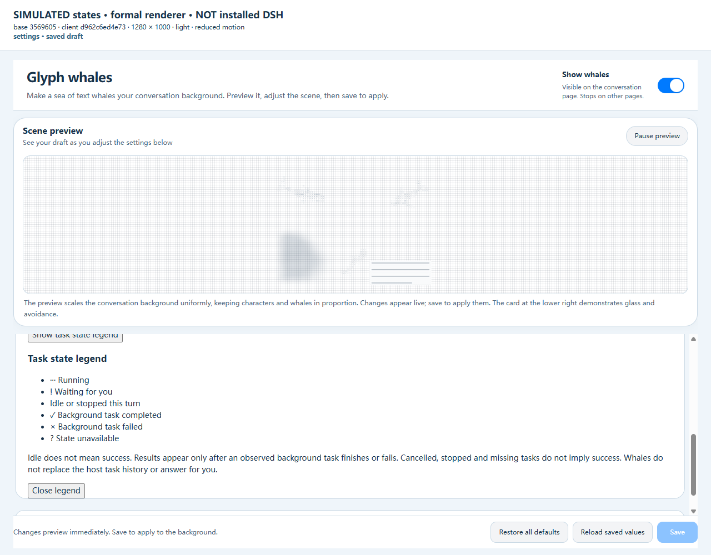

<p align="center">
  
</p>

<h1 align="center">ASCII Whales</h1>

<p align="center">Follow DeepSeek Harness tasks with whales that distinguish running, waiting, and observed background results.</p>

<p align="center"><a href="./README.md">简体中文</a> · <strong>English</strong></p>

<p align="center">
  <a href="https://github.com/jryang1997/dsh-ascii-whales/releases/latest"></a>
</p>

<p align="center">
  <a href="https://github.com/jryang1997/dsh-ascii-whales/releases/latest">Download</a> ·
  <a href="#install">Install</a> · <a href="#settings">Settings</a> ·
  <a href="#local-preview">Local preview</a> · <a href="./CHANGELOG.md">Changelog</a>
</p>

The whales follow the current session, subagents, and visible background tasks. `···` means running. `!` means you need to answer, approve, or review a plan. `✓` and `×` appear only when the plugin first observes a background task running, then sees it complete or fail. **Idle does not mean success.**

<p align="center">
  
</p>

<p align="center"><sub>SIMULATED fixture, NOT an installed DSH recording. Formal client.js, light theme, reduced motion. Four frames show the states in order; Build demo and Check demo are different tasks. See <a href="./docs/research/TASK-DEMO.md">demo provenance and acceptance evidence</a> for build identity, still frames, and reproduction. The actual installed-host status recording is still missing, so that acceptance item in #3 remains unverified.</sub></p>

| Marker | Meaning |
| --- | --- |
| `···` | A session, subagent, or background task is running; a task still stopping also counts as running |
| `!` | Waiting for your answer, approval, or plan review |
| No result marker | Known idle or stopped turn, with calm gliding; this does not imply success |
| `✓` | A background task completed after the plugin observed it running |
| `×` | A background task failed after the plugin observed it running |
| Unavailable or not yet known | A required host capability, current session, or task roster is missing or not yet determined; decoration remains, with no inferred idle or result |

Cancellation, stopping, disconnection, and disappearing tasks do not imply success or failure. Historical results do not pop up on first load. The first-use legend keeps your focus and remembers explicit dismissal; you can reopen it in Settings. The text summary includes task names and states, including tasks without their own whale. Turn off **Follow task activity** to restore decorative swimming. Whales do not replace the host task history or answer or approve for you.

Start with **Scene preset** and choose Default, Rainy, Minimal, or Night voyage. Open **Advanced settings** for individual controls. A preset changes the draft and preview; **Save** applies it to the conversation background. **Reload saved values** discards the draft. See [Settings](#settings).

**Resource mode** is independent of scene presets. Economy reduces continuous scheduling, internal integration, and drawing while keeping task-prompt time independent. In the 45-sample controlled headless Chrome comparison on 2026-10-25, economy observed lower CPU; turning the plugin off used the least CPU. The table shows median single-core-equivalent CPU percentages for the isolated Chrome process tree (n = 5 per cell), including fixture and CDP overhead, rather than plugin-exclusive CPU.

| Simulated scenario | Off | Standard | Economy |
| --- | --- | --- | --- |
| Idle | 0.108 | 42.520 | 19.800 |
| Append | 0.881 | 45.525 | 19.824 |
| Scroll | 7.229 | 48.403 | 27.370 |

With 16 logical processors, divide these values by 16 for whole-machine normalized percentages. See the [full resource report](./docs/research/RESOURCE-COMPARISON.en.md) for ranges, actual work, and independent diagnostics. Actual DSH resource benefits, GPU utilization, and energy remain unmeasured; these observations do not establish battery gains or a general speedup. See the [three-condition method](./docs/measurement.en.md) and [local evidence status](./docs/resource-report-status.md).

> Inspired by [ascii-sharks](https://github.com/stackedlol/ascii-sharks). Thanks to the project for the original visual idea.

Five whale species cruise, turn, and glide through the conversation page, seen from directly above. Their bodies consist of your text or ASCII characters chosen by shading. Whales are drawn locally, without image assets or external services.

<p align="center">
  
</p>

<p align="center"><sub>The DeepSeek Harness home page in the desktop window. The whales cruise across the squared sea. This is the running app.</sub></p>

<p align="center">
  
</p>

<p align="center"><sub>Combine glyphs or colored cells with custom text or ASCII.</sub></p>

## Install

In DSH Web, install from GitHub with the CLI:

```sh
dsh plugin --profile web add github:jryang1997/dsh-ascii-whales
```

Or install the release tarball through the plugin manager:

1. Download a `local-dsh-ascii-ocean-*.tgz` package from [Releases](https://github.com/jryang1997/dsh-ascii-whales/releases/latest) (or enter `github:jryang1997/dsh-ascii-whales` in the plugin manager).
2. Install the file through the DSH plugin manager.
3. Open **Plugins → Glyph whales**, adjust the settings, and select **Save**.

The current published package is [v1.0.0](https://github.com/jryang1997/dsh-ascii-whales/releases/tag/v1.0.0). The full history is in the [changelog](./CHANGELOG.md). All clips on this page use the light theme with the sidebar hidden: the cruise and rain clips are real DSH page recordings, while the dive, fluke and task-activity clips render a single whale with the same renderer so the motion stays readable (glyphs, custom text and a random color per whale). The task-state GIF remains a simulated fixture from the local integrated sources; it does not claim that v1.0.0 shipped these interactions.

## Features

- Form whales from Chinese characters, English text, or emoji. Leave the text blank to use the default phrase, `探索未至之境`.
- Choose blue, humpback, sperm, fin, or bowhead whales, or let a mixed group swim together.
- Draw glyphs alone for a lighter outline, or add colored cells to shade the back, flanks, flippers, and flukes.
- A faint grid of character cells fills the whole sea, and the whale tiles sit on the same lattice. **Squared sea** can be switched off; it is on by default.
- Adjust the count, body size, speed, opacity, and palette. Body size does not change swimming speed or tail-beat timing.
- Apply saved settings while preserving the group's movement. Switching models keeps the whales swimming.
- Version 0.14.0 adds sea-surface wind streaks and slow cloud shadows, each with its own switch. Whales leave through any edge and return on the opposite side, steering clear of obstacles there before they cross. See [atmosphere research](./docs/research/ATMOSPHERE-RESEARCH.md).
- Rain has an independent switch and intensity from 0 to 1. Fine streaks follow the slowly changing sea breeze and make small splashes and spreading ripples at their landing points. Rain settles naturally when switched off. Turning wind off returns the rain to vertical; rain ripples and swimming wakes have separate controls.
- Each whale dives and comes back up on its own. The nose goes under first, the tail lifts and slaps, and the whale keeps its course while it is hidden. The nose returns first. The school does not dive together, and there is no separate dive switch. See the [changelog](./CHANGELOG.md).
- Follow light and dark themes and system preferences. Reduced motion shows a static pose. Hidden pages pause the animation, and the decorative layer lets pointer events pass through.

## Motion

<p align="center">
  
</p>

<p align="center"><sub>One whale rendered on its own: the fluke lifts and disappears last, the whale keeps its course underwater, and the nose returns first.</sub></p>

<p align="center">
  
</p>

<p align="center"><sub>One whale rendered on its own: both fluke lobes beat up and down, and the wake widens behind it. Glyphs and custom text.</sub></p>

## Rain

<p align="center">
  
</p>

<p align="center"><sub>A real DSH light page with the sidebar hidden: streaks follow the slowly turning breeze and leave small splashes and short ripples where they land.</sub></p>

Rain is off by default, with intensity from 0 to 1 and a default of 0.45. Streaks follow a slowly changing sea breeze and change length and speed by layer; turning the sea wind off returns them to vertical rain. Landing splashes and spreading ripples are separate from the swimming wake switch. Rain uses the same reading, media and glass protection, and pauses when the page is hidden, the effect is paused or the system asks for reduced motion.

## Dictation echo

<p align="center">
  
</p>

<p align="center"><sub>A real DSH recording from an earlier version, showing the dictation flow. It has not been re-recorded for the all-whale turning and live-amplitude corrections.</sub></p>

Requires the [dsh-hold-to-dictate](https://github.com/jryang1997/dsh-hold-to-dictate) plugin. **Dictation echo** is on by default in settings and can be switched off; with only the whale plugin installed it does nothing. While a take records, every whale turns toward the composer and slowly approaches it; crowded layouts keep every whale responding as they wait for space. The sea rises and falls from the input box, with louder live speech producing a larger vertical amplitude; silence lets the surface settle. When the take finishes (done) the school disperses. Reduced motion never gathers or advances the swell.

See the [dictation gather research](./docs/research/DICTATION-GATHER.md) for the design trade-offs; the cross-plugin contract lives in the producer's ADR.

## Whales around your conversation

Text edge effect offers Off, Glow, Soft blur and Frosted glass, with Frosted glass as the default. Off leaves whales around text untreated. Glow clears them; blur and frost retain translucent silhouettes behind a paragraph. This choice is independent of the content-box glass switch. Settings start with a large live preview, followed by the first-level scene preset, body text, task-following switch and legend button; Appearance, Whales, Reading, Sea and Layout controls sit in Advanced settings, collapsed by default. Switches control booleans, buttons select modes, and sliders adjust numeric values. While you scroll, the school keeps swimming and the text mask follows the new positions. Content cards, the input box and the right sidebar use frosted materials, with a quieter, more diffuse whale silhouette in the sidebar. Light and dark themes use separate tones. The squared sea sits beneath the school and the cloud shadows, shares the same reading protection as the whales, fades with Background opacity, and has its own switch.

**Pause rendering while scrolling** is under Advanced settings and is off by default. Turn it on and scrolling hides the decorative layer at once and freezes the simulation; about 140 ms after your last scroll it measures the new position once and fades back in — useful when a soft mask feels like it lags behind moving text.

| Light theme | Dark theme |
| :---: | :---: |
|  |  |

For the input box, you can show blurred whale silhouettes or have the whales swim around it.

| Option | Effect | Default |
| --- | --- | --- |
| Frosted content boxes | Blurred whales in content cards, the input box and right sidebar, with clear text regions | On |
| Whales avoid the input box | Whales swim around the input box as an obstacle | Off |

**Frosted content boxes** and **Whales avoid the input box** are mutually exclusive. Enabling either turns the other off. Text edge effects are controlled independently and can also be turned off.

<details>
<summary>View input-box avoidance</summary>

<p></p>

</details>

<details>
<summary>Compare three whale sizes</summary>

<p></p>

</details>

The older reading and size screenshots use the Chinese UI and come from the standalone preview or simulated environments. The new settings fixtures cover both languages, and the settings screenshots below use the English UI. The settings page itself follows the DSH UI language; both English and Simplified Chinese strings ship with the plugin. See [SOURCE-NOTES.md](./docs/research/SOURCE-NOTES.md) for verification details and the limits of testing in the actual DSH desktop window.

## Settings

The settings page follows the DSH UI language. English and Simplified Chinese strings are bundled with the plugin.

Choose Default, Rainy, Minimal, or Night voyage in **Scene preset**. A preset changes the count, speed, opacity, palette, and sea effects together. It preserves your body text, species, drawing style, sizes, reading protection, task following, and layout preferences. Default restores only the preset-owned parameters; **Restore all defaults** resets the whole draft. Editing a scene-owned parameter shows Custom when the combination no longer matches.

A preset or control changes only the draft and preview. **Save** applies it to the conversation background. A failed save or revision conflict keeps your draft without overwriting newer values. **Reload saved values** discards unsaved edits. Valid existing settings survive upgrades without applying a preset. **Show task state legend** opens the initially hidden legend; you can close it again. Advanced settings start collapsed, and all existing controls remain available.

| Numeric setting | Range | Default |
| --- | --- | --- |
| Whale count | 1–8 | 3 |
| Swimming speed | 0.3–2 | 0.65 |
| Background opacity | 0.04–0.9 | 0.6 |
| Character size | 4–16 | 11 |
| Whale size | 0.55–1.55 | 1 |
| Glass strength | 0–1 | 0.55 |
| Rain intensity | 0–1 | 0.45, rain off by default |
| Browser left inset | 0–500 px | 280 px |

| Style setting | Choices |
| --- | --- |
| Whale species | Mixed group, blue, humpback, sperm, fin, or bowhead |
| Drawing style | Glyphs only, colored cells |
| Fill content | Custom text, ASCII characters |
| Whale colors | Ocean, Azure, Indigo, random color per whale |
| Other switches | Show whales, Squared sea, Follow task activity, Dictation echo, Quieter reading area |

Random color per whale assigns distinct hues from eight palettes and retains body shading. Painting, saving settings, resizing, and changing count, text, species or size preserve each whale's color. Reopening the background generates a new set.

Follow task activity is on by default. The first whale represents the current session. The remaining whales keep stable bindings to related subagents and background tasks visible to the current session.

| Actual state | Whale behavior |
| --- | --- |
| Running session, subagent or job | Stronger swimming, more sustained tail strokes, `···` |
| Idle or stopped turn | Calm gliding; an inactive subagent does not imply success |
| Waiting for an answer, approval or plan review | Smooth surfacing, slow swimming, `!` and the task name; no new dives |
| Background task completion or failure after observed running | `✓` or `×` and the task name for six seconds of simulation time; pausing simulation pauses this clock |
| Missing capability or undetermined state | Unavailable or not-yet-known text, with no inferred idle or result |

When there are more tracked tasks than whales, the first whale summarizes the extra count and the most urgent reminder. Disabling the switch restores decorative swimming. Reduced motion keeps the pose still while state changes update static badges. The plugin only reads published DSH state. It does not answer questions, approve operations or follow job output. Historical job results do not produce new badges when the background opens.

<p align="center">
  
</p>

<p align="center"><sub>One whale rendered on its own: <code>···</code> while working, <code>!</code> while waiting for approval, <code>✓</code> on completion and <code>×</code> on failure; task names come from DSH.</sub></p>

Custom text supports Chinese characters, English, emoji, and combined glyphs. Whitespace is ignored. The input limit is 40 UTF-16 code units, so some emoji use more than one unit. Switching to ASCII preserves your saved custom text.

The desktop app follows the sidebar width automatically. In a regular browser, adjust **Browser left inset** to position the visible whale area. **Pause rendering while scrolling** sits in the same Advanced settings group, off by default.

<details>
<summary>View the settings page</summary>

<p></p>
<p></p>

These simulated fixtures use the formal settings component, not installed DSH screenshots. The options scroll while the preview and save area stay visible. The existing English UI label remains **Glyph whales**; ASCII Whales is the public name in this introduction. See [demo provenance](./docs/research/TASK-DEMO.md) for build identity.

</details>

## Local preview

Download or clone the repository, then open [whale-preview.html](./preview/whale-preview.html) in your browser. It uses the plugin's renderer and does not need a server.

The page includes all four rendering combinations and a live group of whales. Change the species, body text, size, speed, glass, and theme, or try **Pause rendering while scrolling**. A simulated input box at the bottom lets you compare frosted glass with avoidance.

## Development

```text
src/             Implementation sources
tests/           Tests and helpers/ adapters
scripts/         Build and preview generators (verification tooling is a devDependency)
preview/         Standalone entry and generated page
docs/research/   Research and design records
docs/images/     Screenshots and clips
```

The root keeps the public plugin entry `index.js`, the DSH client artifact `client.js`, installation configuration, and project documentation. Historical screenshots remain in `docs/archive/`.

<details>
<summary>Build, check, and package</summary>

Use the Node version in [.node-version](./.node-version) and the pnpm version pinned in [package.json](./package.json). From the project root:

```sh
pnpm install --frozen-lockfile
pnpm verify
```

After changing browser sources, run `pnpm build` and `pnpm preview` to update both artifacts, then run `pnpm verify`. Verification checks committed output without rebuilding it, so stale artifacts fail. Test discovery recursively includes `*.test.js` under `tests/`, excluding hidden directories and `node_modules/`. It does not scan repository backups, reference projects, or worktree copies. GitHub Actions runs the same verification on Windows and Linux.

Verification, packaging, and review share the dev dependency [@jryang1997/dsh-plugin-kit](https://github.com/jryang1997/dsh-plugin-kit) (pinned to tag v1.0.0, configured under `dshPluginKit` in [package.json](./package.json)): `pnpm check` runs manifest, locale, README, version, and syntax checks; `pnpm test` discovers and runs tests; `pnpm verify` checks static items, artifacts, the published tarball, the screenshots manifest, and tests. `pnpm --silent review:snapshot --base <ref>` outputs a JSON review inventory including untracked files. `pnpm --silent agent:probe` checks whether its process can read the entry files. See the [engineering guide](./docs/agents/engineering.md) for native-tool read preflight, review scope, and browser evidence requirements.

The published tarball contains runtime files, `locale/`, the icon, README/CHANGELOG, and `docs/images/` plus `docs/research/`; the pack check rejects development paths such as `tests/`, `scripts/`, `preview/`, and `.node-version`. The kit is pinned through its v1.0.0 GitHub tarball; git access to GitHub is restricted on this machine, so the dependency uses a codeload URL instead of a `git+https` specifier.

Package with `pnpm --config.ignore-scripts=true pack`.

`pnpm build` runs [build.mjs](./scripts/build.mjs) to generate [client.js](./client.js) from [browser-entry.js](./src/browser-entry.js). `pnpm preview` runs [preview.mjs](./scripts/preview.mjs) to generate the [standalone page](./preview/whale-preview.html) from [preview-client.js](./preview/preview-client.js). Both entries use [browser-build.mjs](./scripts/browser-build.mjs) and the esbuild development dependency to resolve imports and isolate file scopes; the installed plugin does not need esbuild. Both generators support `--check` to verify source consistency. The package name is `@local/dsh-ascii-ocean`, and the Host row id is `ascii-whale-background`.

| File | Purpose |
| --- | --- |
| [species.js](./src/species.js) | Body shapes and movement parameters for the five species |
| [model.js](./src/model.js) | Surfaces, projection, cell coverage, and configuration fingerprints |
| [motion.js](./src/motion.js) | Cruising, turning, gliding, and input-box avoidance |
| [rig.js](./src/rig.js) | Body turns and vertical tail strokes |
| [shading.js](./src/shading.js) | Raised-back and depth shading |
| [surface.js](./src/surface.js) | Character selection, palettes, and cell drawing |
| [glass.js](./src/glass.js) | Reading-pane and input-box geometry and materials |
| [engine.js](./src/engine.js) | Canvas drawing and updates in place |
| [reading-layout.js](./src/reading-layout.js) | Shared glass, masks, and avoidance rules for conversation and demo cards |
| [activity.js](./src/activity.js) | Published DSH state, stable task bindings, job subscriptions, and badges |
| [dictation.js](./src/dictation.js) | Dictation bridge, gather band and slot geometry, breathing and easing |
| [voice-sea.js](./src/voice-sea.js) | Voice-driven sea swell field and drawer |
| [rain.js](./src/rain.js) | Wind-driven rain, intensity transitions, and impact ripples |
| [sea-grid.js](./src/sea-grid.js) | Squared sea hairline lattice, theme ink, and device-pixel snapping |
| [simulation.js](./src/simulation.js) | Scene adoption, resizing, and advancement of motion and sea effects |
| [config-editor.js](./src/config-editor.js) | Draft rules, validation, differential saves, and revision conflicts |
| [browser-build.mjs](./scripts/browser-build.mjs) | Shared browser artifact assembly and consistency checks |
| [settings.js](./src/settings.js) | Native DSH settings page |

</details>

## Documentation and references

The following reference documents are in Chinese:

- [Changelog](./CHANGELOG.md): version history and upgrade changes.
- [Implementation and verification notes](./docs/research/SOURCE-NOTES.md): implementation details, root causes, and testing limits.
- [ASCII rendering research](./docs/research/ASCII-RENDER-NOTES.md): cell rendering and character density.
- [Whale references](./docs/research/WHALE-REFERENCES.md): overhead photographs used as species references.
- [Screenshot archive](./docs/archive): visual records of earlier versions.

Reference photographs, local verification evidence, and the third-party reference checkout are kept outside the published project. See [.gitignore](./.gitignore) for the directory rules.
