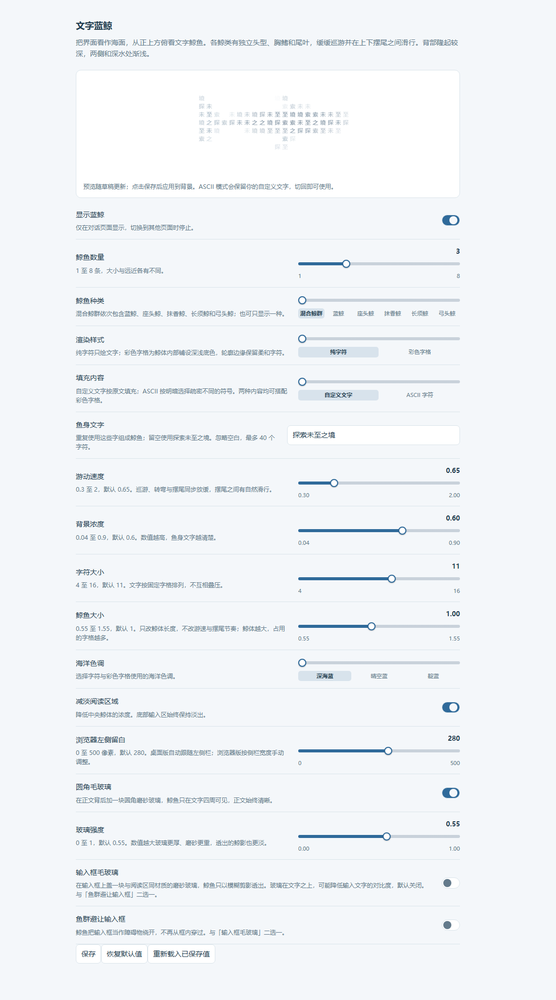

<p align="center">
  
</p>

<h1 align="center">文字蓝鲸</h1>

<p align="center">让你写下的文字，变成在 DeepSeek Harness 对话页巡游的鲸鱼。</p>

<p align="center"><strong>简体中文</strong> · <a href="./README.en.md">English</a></p>

<p align="center">
  <a href="https://github.com/jryang1997/dsh-ascii-whales/releases/latest"></a>
</p>

<p align="center">
  <a href="https://github.com/jryang1997/dsh-ascii-whales/releases/latest">下载安装包</a> ·
  <a href="#安装">安装</a> · <a href="#设置">设置</a> ·
  <a href="#本地预览">本地预览</a> · <a href="./CHANGELOG.md">更新日志</a>
</p>

> 感谢 [ascii-sharks](https://github.com/stackedlol/ascii-sharks)，最初的画面灵感来自这个项目。

从海面正上方看，五种鲸鱼用文字和字格组成身体，缓缓摆尾、转向、滑行。鱼身可以使用你自己的文字，也可以按明暗填入 ASCII 字符。鲸体在本地绘制，无需图片素材或外部服务。

<p align="center">
  
</p>

<p align="center"><sub>纯字符与彩色字格、自定义文字与 ASCII，可以自由组合。</sub></p>

## 安装

1. 从 [Releases](https://github.com/jryang1997/dsh-ascii-whales/releases/latest) 下载 `local-dsh-ascii-ocean-*.tgz` 安装包。
2. 在 DSH 插件管理器中安装该文件。
3. 打开 **插件 → 文字蓝鲸**，调整选项后点击 **保存**。

目前发布的安装包为 [v0.14.0](https://github.com/jryang1997/dsh-ascii-whales/releases/tag/v0.14.0)。0.10.0 之后的变化见[更新日志](./CHANGELOG.md)。下方截图来自独立预览，不覆盖每一项新开关。

## 能做什么

- 用中文、英文或 emoji 组成鲸鱼。留空时使用「探索未至之境」。
- 在蓝鲸、座头鲸、抹香鲸、长须鲸、弓头鲸之间选择，也可以让它们混合巡游。
- 用纯字符呈现轻淡轮廓，或加上彩色字格，显示背部、侧身与鳍尾的明暗。
- 调整数量、体长、速度、浓度和配色。改变体长不会改变游速与摆尾节奏。
- 保存设置后更新鲸群状态，切换模型时继续巡游。
- 本地 0.14.0 加入海面风纹与慢移云影，两个开关独立控制；鲸鱼从四边穿屏，提前避开另一侧的障碍。实现与来源见 [海面风云研究](./ATMOSPHERE-RESEARCH.md)。
- 跟随深浅主题与系统偏好。减少动态效果时显示静态姿态，页面隐藏时暂停，装饰层不拦截鼠标操作。

## 画面与阅读

磨砂阅读区让正文背后的鲸影变得柔和。深浅主题使用各自的玻璃材质。

| 浅色主题 | 深色主题 |
| :---: | :---: |
|  |  |

输入框可以保留模糊鲸影，也可以让鲸鱼绕开它。

| 选项 | 效果 | 默认 |
| --- | --- | --- |
| 圆角毛玻璃 | 在正文背后形成一整块磨砂阅读区 | 开启 |
| 输入框毛玻璃 | 输入框内的鲸鱼以模糊剪影透出 | 关闭 |
| 鱼群避让输入框 | 鲸鱼把输入框当作障碍，绕开后继续巡游 | 关闭 |

**输入框毛玻璃**与**鱼群避让输入框**互斥，开启其中一项会关闭另一项。正文阅读区的毛玻璃可以独立调整。

<details>
<summary>查看输入框避让效果</summary>

<p></p>

</details>

<details>
<summary>比较三档鲸鱼大小</summary>

<p></p>

</details>

这里的截图来自独立预览或仿真环境。真实 DSH 桌面窗口中的最终观感与验证边界见 [SOURCE-NOTES.md](./SOURCE-NOTES.md)。

## 设置

拖动滑杆时，设置页的静态样例会更新；点击 **保存** 后，草稿才应用到对话背景。**恢复默认值**修改草稿，**重新载入已保存值**丢弃未保存的调整。

| 数值选项 | 范围 | 默认值 |
| --- | --- | --- |
| 鲸鱼数量 | 1–8 | 3 |
| 游动速度 | 0.3–2 | 0.65 |
| 背景浓度 | 0.04–0.9 | 0.6 |
| 字符大小 | 4–16 | 11 |
| 鲸鱼大小 | 0.55–1.55 | 1 |
| 玻璃强度 | 0–1 | 0.55 |
| 浏览器左侧留白 | 0–500 px | 280 px |

| 样式选项 | 可选内容 |
| --- | --- |
| 鲸鱼种类 | 混合鲸群、蓝鲸、座头鲸、抹香鲸、长须鲸、弓头鲸 |
| 渲染样式 | 纯字符、彩色字格 |
| 填充内容 | 自定义文字、ASCII 字符 |
| 海洋色调 | 深海蓝、晴空蓝、靛蓝 |
| 其他开关 | 显示蓝鲸、减淡阅读区域 |

鱼身文字支持中文、英文、emoji 和组合字形，空白会被忽略。输入上限为 40 个 UTF-16 代码单元，部分 emoji 会占用多个单位。切换到 ASCII 不会改写已保存的自定义文字。

桌面版自动跟随左侧栏宽度；在普通浏览器中，可用 **浏览器左侧留白** 调整鲸群的可见区域。

<details>
<summary>查看设置页</summary>

<p></p>

</details>

## 本地预览

下载或克隆仓库后，用浏览器打开 [whale-preview.html](./whale-preview.html)。页面使用插件的正式渲染器，不需要启动服务器。

预览包含四种渲染组合和实时鲸群，可以切换鲸类、鱼身文字、大小、速度、玻璃与深浅主题。页面底部的模拟输入框用于比较毛玻璃和避让效果。

## 开发

<details>
<summary>构建、检查与打包</summary>

在项目根目录安装依赖，然后运行所需命令：

```sh
npm install
npm run build
node preview.mjs
npm run check
npm test
node build.mjs --check
npm pack --ignore-scripts
```

`npm run build` 从源码生成 `client.js`，`node preview.mjs` 生成独立预览页。包名为 `@local/dsh-ascii-ocean`，Host 行 id 为 `ascii-whale-background`。

| 文件 | 职责 |
| --- | --- |
| [species.js](./species.js) | 五种鲸类的体型与动作参数 |
| [model.js](./model.js) | 表面、投影、字格覆盖与配置指纹 |
| [motion.js](./motion.js) | 巡游、转向、滑行与输入框避让 |
| [rig.js](./rig.js) | 身体转向与上下尾拍 |
| [shading.js](./shading.js) | 背部隆起与水深字色 |
| [surface.js](./surface.js) | 字符选择、色表与字格绘制 |
| [glass.js](./glass.js) | 阅读区与输入框的面板几何及材质 |
| [engine.js](./engine.js) | Canvas 绘制与原地更新 |
| [settings.js](./settings.js) | DSH 原生设置页 |

</details>

## 文档与参考

- [更新日志](./CHANGELOG.md)：版本历史与升级变化。
- [实现与验证记录](./SOURCE-NOTES.md)：实现细节、问题根因与验证边界。
- [ASCII 渲染研究](./ASCII-RENDER-NOTES.md)：字格与字符密度的机制核对。
- [鲸类造型参考](./WHALE-REFERENCES.md)：五种鲸类的俯视照片依据。
- [历史截图](./docs/archive)：早期版本的视觉记录。

真实参考照片、本地验证证据与第三方参考仓库不随项目发布，目录规则见 [.gitignore](./.gitignore)。
