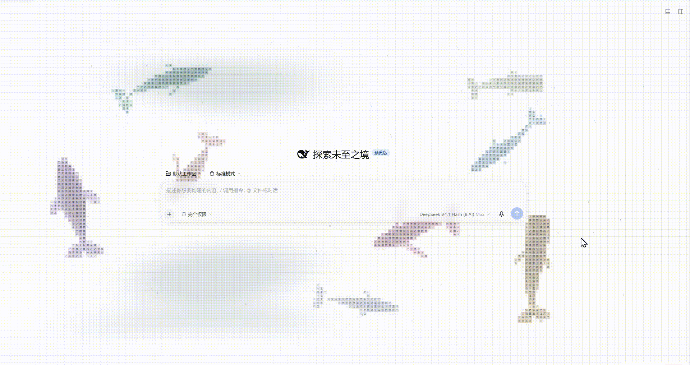
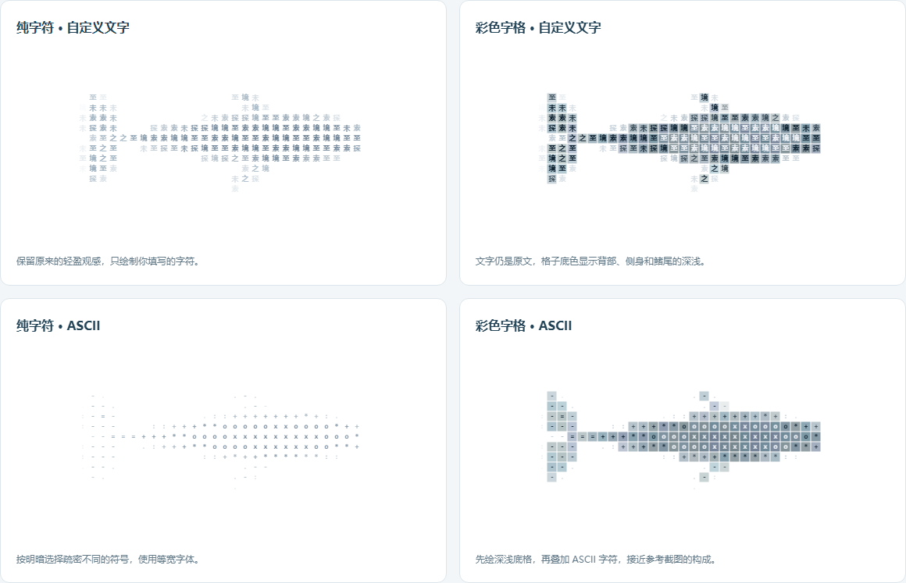
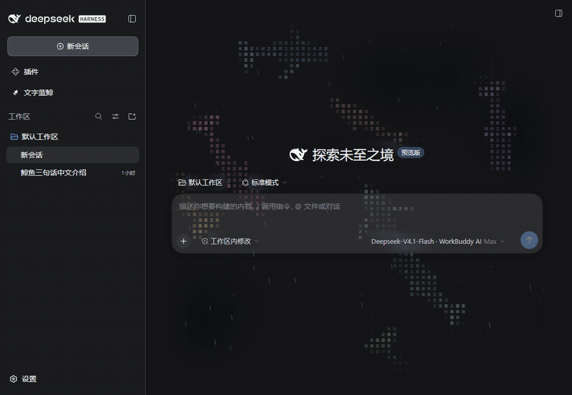
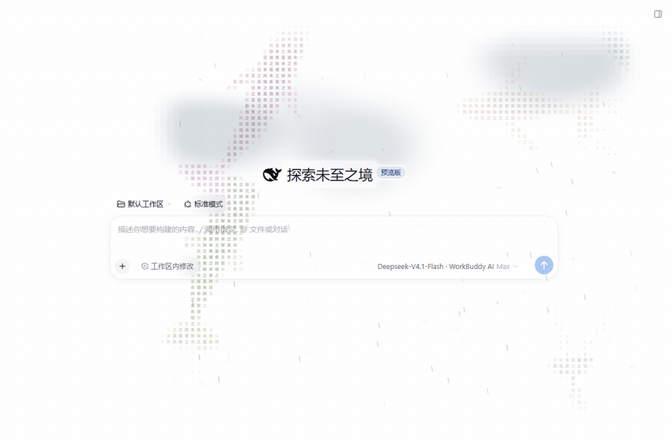
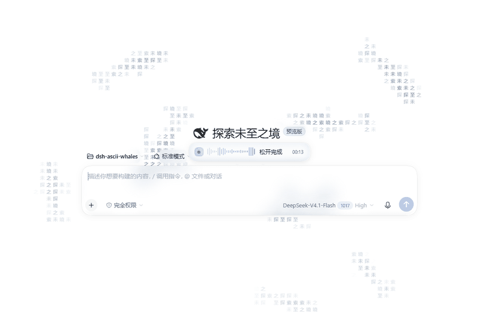
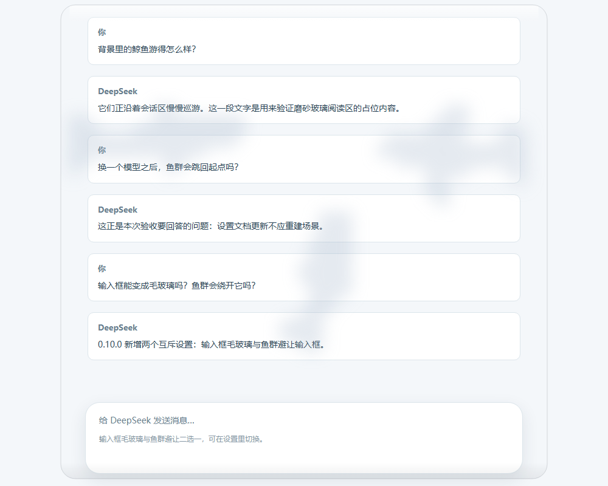
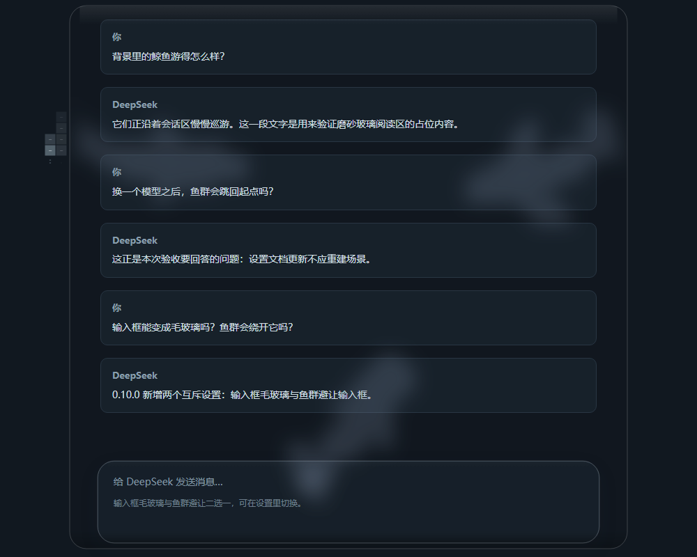
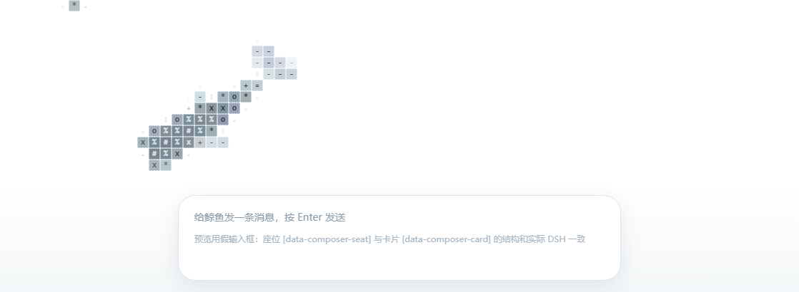
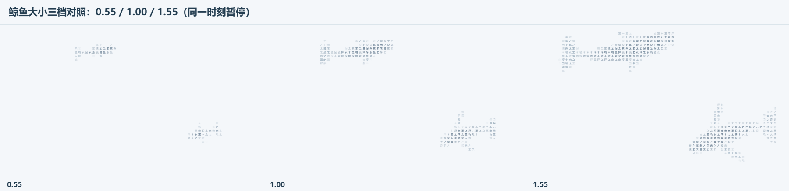
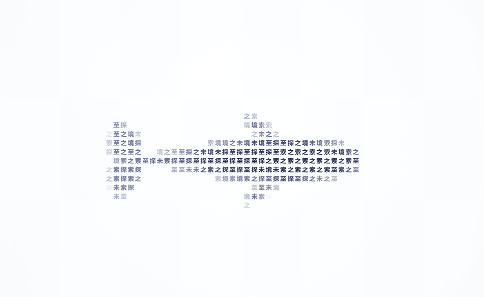

<p align="center">
  
</p>

<h1 align="center">文字蓝鲸</h1>

<p align="center">让你写下的文字，变成在 DeepSeek Harness 对话页巡游的鲸鱼。</p>

<p align="center"><strong>简体中文</strong> · <a href="./README.en.md">English</a></p>

<p align="center">
  <a href="https://github.com/jryang1997/dsh-ascii-whales/releases/latest"></a>
</p>

<p align="center">
  <a href="https://github.com/jryang1997/dsh-ascii-whales/releases/latest">下载安装包</a> ·
  <a href="#安装">安装</a> · <a href="#设置">设置</a> ·
  <a href="#本地预览">本地预览</a> · <a href="./CHANGELOG.md">更新日志</a>
</p>

> 感谢 [ascii-sharks](https://github.com/stackedlol/ascii-sharks)，最初的画面灵感来自这个项目。

从海面正上方看，五种鲸鱼用文字和字格组成身体，缓缓摆尾、转向、滑行。鱼身可以使用你自己的文字，也可以按明暗填入 ASCII 字符。鲸体在本地绘制，无需图片素材或外部服务。

<p align="center">
  
</p>

<p align="center"><sub>桌面窗口里的空白对话页。鲸鱼围着输入框游，这是实际运行的画面。</sub></p>

<p align="center">
  
</p>

<p align="center"><sub>纯字符与彩色字格、自定义文字与 ASCII，可以自由组合。</sub></p>

## 安装

在 DSH Web 中可通过命令行安装：

```sh
dsh plugin --profile web add github:jryang1997/dsh-ascii-whales
```

也可以在桌面端或插件管理器中安装安装包：

1. 从 [Releases](https://github.com/jryang1997/dsh-ascii-whales/releases/latest) 下载 `local-dsh-ascii-ocean-*.tgz` 安装包（或在插件管理器填入 `github:jryang1997/dsh-ascii-whales`）。
2. 在 DSH 插件管理器中安装该文件。
3. 打开 **插件 → 文字蓝鲸**，调整选项后点击 **保存**。

目前发布的安装包为 [v0.15.0](https://github.com/jryang1997/dsh-ascii-whales/releases/tag/v0.15.0)。0.10.0 之后的变化见[更新日志](./CHANGELOG.md)。本页动图统一使用白色主题并隐藏侧栏：巡游与落雨是真实 DSH 页面录屏；下潜、拍尾与任务状态用同一套渲染器单独渲染单条鲸鱼，便于看清动作，鲸鱼为「纯字符 + 自定义文字 + 每条随机配色」。

## 能做什么

- 用中文、英文或 emoji 组成鲸鱼。留空时使用「探索未至之境」。
- 在蓝鲸、座头鲸、抹香鲸、长须鲸、弓头鲸之间选择，也可以让它们混合巡游。
- 用纯字符呈现轻淡轮廓，或加上彩色字格，显示背部、侧身与鳍尾的明暗。
- 整片海面铺着与字格同源的浅色方格，鲸体的字格落在同一套格线上；「海面方格」可单独关闭，默认开启。
- 调整数量、体长、速度、浓度和配色。改变体长不会改变游速与摆尾节奏。
- 保存设置后更新鲸群状态，切换模型时继续巡游。
- 本地 0.14.0 加入海面风纹与慢移云影，两个开关独立控制；鲸鱼从四边穿屏，提前避开另一侧的障碍。实现与来源见 [海面风云研究](./docs/research/ATMOSPHERE-RESEARCH.md)。
- 「海上落雨」可独立开关，雨量从 0 到 1 调整。雨丝随海面风向缓慢偏转，落点带出细小水花和逐渐展开的涟漪。关雨后自然收尾，关闭海面风纹后逐渐回到直雨；雨水纹与鲸鱼尾流分别控制。
- 游动和滑行会沿航迹留下逐渐展开、消散的 ASCII 尾流，用力拍尾时仍有少量碎水。设置中的「游动尾流与水花」可统一开关，水纹会让开阅读区。
- 鲸会各自下潜再浮上来。吻端先入水，尾鳍抬起后拍一下。水下仍沿原航线游，只是看不见。浮出时鼻端先回来。不是整群一起，也没有单独开关。详见[更新日志](./CHANGELOG.md)。
- 跟随深浅主题与系统偏好。减少动态效果时显示静态姿态，页面隐藏时暂停，装饰层不拦截鼠标操作。

## 动作

<p align="center">
  
</p>

<p align="center"><sub>一条鲸单独渲染的下潜：尾鳍先抬起、最后消失，水下沿原航线继续游，过几秒鼻端先回来。</sub></p>

<p align="center">
  
</p>

<p align="center"><sub>一条鲸单独渲染的摆尾：两片尾叶上下拍动，身后水纹逐渐展开。鲸鱼使用纯字符与自定义文字。</sub></p>

## 海上落雨

<p align="center">
  
</p>

<p align="center"><sub>真实 DSH 浅色页面，隐藏侧栏：雨丝随风向缓慢偏转，落到海面时带出碎水和短暂涟漪。</sub></p>

「海上落雨」默认关闭，雨量从 0 到 1，默认 0.45。雨丝跟随缓慢变化的海面风场，前后层长短与速度不同；关掉海面风纹后会慢慢回到直雨。雨滴落点带出碎水与扩散断纹，和鲸鱼游动尾流是两个独立开关。降雨沿用阅读区、媒体与毛玻璃保护；页面隐藏、暂停或系统要求减少动态时不继续推进。

## 听写联动

<p align="center">
  
</p>

<p align="center"><sub>早期版本的真实 DSH 页面录屏，展示听写联动流程。本次全体转向与实时振幅修正尚未重录。</sub></p>

需要另装 [dsh-hold-to-dictate](https://github.com/jryang1997/dsh-hold-to-dictate)（按住说话）插件。设置里的「听写联动」默认开启，也可单独关闭；只装文字蓝鲸时这个开关不产生任何效果。录音期间每一头鲸鱼都会转向输入框，并缓慢靠近；空间拥挤时也不会遗漏个体，而是在输入框周围等待空间。海面以输入框为声源上下起伏，实时声音越响，振动的振幅越大；没有声音时逐渐恢复平静。转写结束（done）后鲸群散开。系统要求减少动态时不聚集、不推进声浪。

设计取舍与边界见 [听写聚集研究](./docs/research/DICTATION-GATHER.md)；跨插件契约见对应仓库的 ADR。

## 画面与阅读

「文字边缘效果」可选关闭、微光、柔和模糊或毛玻璃，默认毛玻璃。关闭后不对文字附近的鲸鱼额外处理；微光让文字附近的鲸鱼隐去；模糊和毛玻璃保留半透明鲸影，鲸身经过正文时仍然连贯。这个选项独立于「内容框毛玻璃」。设置页顶部为实时大预览，下方按外观、鲸群、阅读、海面分组；开关、分段按钮和数值滑块各司其职。滚动阅读时鲸群照常巡游，文字遮罩跟随文字的新位置刷新。内容卡片、输入框和右侧边栏各自使用磨砂材质，右侧栏的鲸影更淡、模糊更重；深浅主题分别配色。海面方格铺在鲸群与云影之下，和鲸身共用同一套阅读保护，随「背景浓度」一起变淡，也能用「海面方格」单独关闭。

**滚动时暂停渲染**在「高级设置」里，默认关闭。开启后滚动一开始就暂退装饰层并暂停仿真，手停下约 140 毫秒后按新位置测量一次再淡入恢复，适合觉得柔边遮罩跟不上移动文字的情况。

| 浅色主题 | 深色主题 |
| :---: | :---: |
|  |  |

输入框可以保留模糊鲸影，也可以让鲸鱼绕开它。

| 选项 | 效果 | 默认 |
| --- | --- | --- |
| 内容框毛玻璃 | 内容卡片、输入框和右侧栏显示模糊鲸影，文字区域保持清晰 | 开启 |
| 鱼群避让输入框 | 鲸鱼把输入框当作障碍，绕开后继续巡游 | 关闭 |

**内容框毛玻璃**与**鱼群避让输入框**互斥，开启其中一项会关闭另一项。文字边缘效果由自己的选项独立控制，也可以单独关闭。

<details>
<summary>查看输入框避让效果</summary>

<p></p>

</details>

<details>
<summary>比较三档鲸鱼大小</summary>

<p></p>

</details>

这里的截图来自独立预览或仿真环境。真实 DSH 桌面窗口中的最终观感与验证边界见 [SOURCE-NOTES.md](./docs/research/SOURCE-NOTES.md)。

## 设置

设置页跟随 DSH 的界面语言，内置简体中文与 English 两套文案。

左侧栏的「插件」下方常驻「文字蓝鲸」入口，点击即可打开预览与设置。也可从 **插件 → 文字蓝鲸** 进入同一设置页。

拖动滑杆时，设置页的静态样例会更新；点击 **保存** 后，草稿才应用到对话背景。**恢复默认值**修改草稿，**重新载入已保存值**丢弃未保存的调整。

| 数值选项 | 范围 | 默认值 |
| --- | --- | --- |
| 鲸鱼数量 | 1–8 | 3 |
| 游动速度 | 0.3–2 | 0.65 |
| 背景浓度 | 0.04–0.9 | 0.6 |
| 字符大小 | 4–16 | 11 |
| 鲸鱼大小 | 0.55–1.55 | 1 |
| 玻璃强度 | 0–1 | 0.55 |
| 雨量 | 0–1 | 0.45，落雨默认关闭 |
| 浏览器左侧留白 | 0–500 px | 280 px |

| 样式选项 | 可选内容 |
| --- | --- |
| 鲸鱼种类 | 混合鲸群、蓝鲸、座头鲸、抹香鲸、长须鲸、弓头鲸 |
| 渲染样式 | 纯字符、彩色字格 |
| 填充内容 | 自定义文字、ASCII 字符 |
| 鲸鱼配色 | 深海蓝、晴空蓝、靛蓝、每条随机配色 |
| 其他开关 | 显示蓝鲸、海面方格、跟随任务状态、听写联动、减淡阅读区域 |

选择「每条随机配色」后，每头鲸鱼从八种色系中随机分得一种，鲸体内部仍保留明暗。同一片海里的颜色不会随绘制或保存设置重新抽取；改数量、文字、鲸类和大小也会接续原色。重新打开背景时会生成新的一组配色。

「跟随任务状态」默认开启。第一头对应当前会话，其余按身份绑定子代理、其他活跃会话与当前会话可见的后台任务。列表更新不会让已绑定的鲸鱼互换位置。

| 实际状态 | 鲸鱼表现 |
| --- | --- |
| 会话、子代理或后台任务运行中 | 更有力地巡游，划水更持续，显示 `···` |
| 空闲或本轮停止 | 慢速滑行，子代理停止不会被当成任务成功 |
| 等待回答、审批或计划审阅 | 平滑回到水面，慢游并显示 `!` 和任务名称，等待期间不再下潜 |
| 已观察到的后台任务完成 / 失败 | 显示 `✓` / `×` 与任务名称，继续播放六秒后消失 |

鲸鱼不足时，第一头汇总额外活跃任务的数量，并显示其中最紧急的提醒。关闭联动后恢复装饰游动。系统减少动态效果时不推进动作，状态变化仍会更新静态提示。此功能只读取 DSH 已发布的状态，不回答问题、不批准操作，也不读取后台输出。首次打开时已有的历史任务结果不会弹出提示。

<p align="center">
  
</p>

<p align="center"><sub>一条鲸单独渲染的状态提示：巡游中 <code>···</code>，等待审批 <code>!</code>，任务完成 <code>✓</code>，失败 <code>×</code>；任务名称来自 DSH。</sub></p>

鱼身文字支持中文、英文、emoji 和组合字形，空白会被忽略。输入上限为 40 个 UTF-16 代码单元，部分 emoji 会占用多个单位。切换到 ASCII 不会改写已保存的自定义文字。

桌面版自动跟随左侧栏宽度；在普通浏览器中，可用 **浏览器左侧留白** 调整鲸群的可见区域。**滚动时暂停渲染** 同属高级设置，默认关闭。

<details>
<summary>查看设置页</summary>

<p></p>

</details>

## 本地预览

下载或克隆仓库后，用浏览器打开 [whale-preview.html](./preview/whale-preview.html)。页面使用插件的正式渲染器，不需要启动服务器。

预览包含四种渲染组合和实时鲸群，可以切换鲸类、鱼身文字、大小、速度、玻璃与深浅主题，也可试开「滚动时暂停渲染」。页面底部的模拟输入框用于比较毛玻璃和避让效果。

## 开发

```text
src/             实现源码
tests/           测试与 helpers/ 适配器
scripts/         构建与预览生成入口（验证工具由 devDependency 提供）
preview/         独立预览入口与生成页面
docs/research/   研究与设计记录
docs/images/     截图和动图
```

根目录保留插件公开入口 `index.js`、DSH 客户端产物 `client.js`、安装配置及项目说明。历史截图仍在 `docs/archive/`。

<details>
<summary>构建、检查与打包</summary>

使用 [.node-version](./.node-version) 指定的 Node，以及 [package.json](./package.json) 中固定的 pnpm 版本。在项目根目录运行：

```sh
pnpm install --frozen-lockfile
pnpm verify
```

修改浏览器源码后，先用 `pnpm build` 和 `pnpm preview` 更新两个生成产物，再运行 `pnpm verify`。验证只检查、不重建，过期产物会直接失败。测试只递归发现 `tests/` 下的 `*.test.js`，排除隐藏目录与 `node_modules/`；不会扫描仓库中的临时备份、参考项目或 worktree 副本。GitHub Actions 在 Windows 与 Linux 执行同一验证入口。

验证、打包与审查共用开发依赖 [@jryang1997/dsh-plugin-kit](https://github.com/jryang1997/dsh-plugin-kit)（v1.0.0 固定 tag，`dshPluginKit` 配置在 [package.json](./package.json)）：`pnpm check` 跑清单、locale、README、版本与语法检查，`pnpm test` 发现并运行测试，`pnpm verify` 依次检查静态项、生成物、发布包、截图清单和测试。`pnpm --silent review:snapshot --base <ref>` 输出包含新增文件的 JSON 审查清单；`pnpm --silent agent:probe` 探测当前命令进程能否读取入口文件。派单前的原生工具读取预检、审查范围与浏览器证据要求见 [工程说明](./docs/agents/engineering.md)。

发布包只包含运行文件、`locale/`、图标、README/CHANGELOG 与 `docs/images/`、`docs/research/`；`tests/`、`scripts/`、`preview/`、`.node-version` 等开发路径由打包检查拒绝。kit 以 v1.0.0 tag 的 GitHub tarball 固定引用；本机 git 访问 GitHub 受限，因此不用 `git+https` 说明符。

打包使用 `pnpm --config.ignore-scripts=true pack`。

`pnpm build` 运行 [build.mjs](./scripts/build.mjs)，从 [browser-entry.js](./src/browser-entry.js) 生成 [client.js](./client.js)；`pnpm preview` 运行 [preview.mjs](./scripts/preview.mjs)，从 [preview-client.js](./preview/preview-client.js) 生成 [独立预览页](./preview/whale-preview.html)。两个入口共用 [browser-build.mjs](./scripts/browser-build.mjs) 和开发依赖 esbuild，自动解析依赖并隔离文件作用域；正式插件运行不依赖 esbuild。两种产物都支持 `--check` 检查是否与源码一致。包名为 `@local/dsh-ascii-ocean`，Host 行 id 为 `ascii-whale-background`。

| 文件 | 职责 |
| --- | --- |
| [species.js](./src/species.js) | 五种鲸类的体型与动作参数 |
| [model.js](./src/model.js) | 表面、投影、字格覆盖与配置指纹 |
| [motion.js](./src/motion.js) | 巡游、转向、滑行与输入框避让 |
| [rig.js](./src/rig.js) | 身体转向与上下尾拍 |
| [shading.js](./src/shading.js) | 背部隆起与水深字色 |
| [surface.js](./src/surface.js) | 字符选择、色表与字格绘制 |
| [glass.js](./src/glass.js) | 阅读区与输入框的面板几何及材质 |
| [engine.js](./src/engine.js) | Canvas 绘制与原地更新 |
| [reading-layout.js](./src/reading-layout.js) | 真实对话与演示卡片共用的玻璃、遮罩和避让规则 |
| [activity.js](./src/activity.js) | DSH 状态读取、任务身份绑定、后台订阅与状态徽记 |
| [dictation.js](./src/dictation.js) | 听写状态桥、聚集带与槽位几何、呼吸与缓动 |
| [voice-sea.js](./src/voice-sea.js) | 声音驱动的海面声浪场与绘制 |
| [rain.js](./src/rain.js) | 随风雨丝、雨量过渡与落点水纹 |
| [sea-grid.js](./src/sea-grid.js) | 铺满海面的字格方格、主题墨色与设备像素对齐 |
| [simulation.js](./src/simulation.js) | 鲸群状态接续、尺寸变化以及动作与海面效果的推进顺序 |
| [config-editor.js](./src/config-editor.js) | 草稿互斥、校验、差量保存和版本冲突处理 |
| [browser-build.mjs](./scripts/browser-build.mjs) | 两种浏览器产物的依赖组装与一致性检查 |
| [settings.js](./src/settings.js) | DSH 原生设置页 |

</details>

## 文档与参考

- [更新日志](./CHANGELOG.md)：版本历史与升级变化。
- [实现与验证记录](./docs/research/SOURCE-NOTES.md)：实现细节、问题根因与验证边界。
- [ASCII 渲染研究](./docs/research/ASCII-RENDER-NOTES.md)：字格与字符密度的机制核对。
- [鲸类造型参考](./docs/research/WHALE-REFERENCES.md)：五种鲸类的俯视照片依据。
- [历史截图](./docs/archive)：早期版本的视觉记录。

真实参考照片、本地验证证据与第三方参考仓库不随项目发布，目录规则见 [.gitignore](./.gitignore)。
