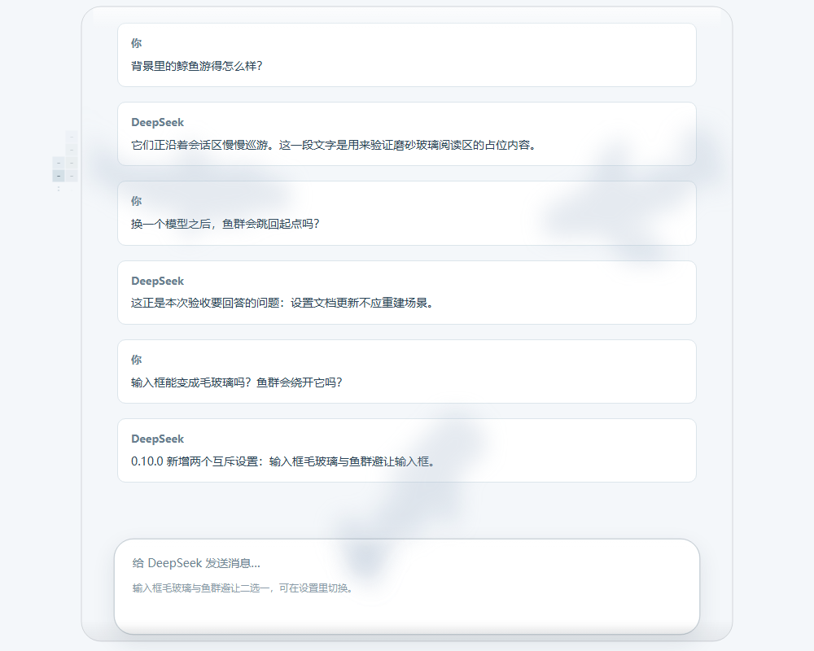

# 文字蓝鲸

[](https://github.com/jryang1997/dsh-ascii-whales/releases/latest)

DSH（DeepSeek Harness）对话页的背景层：从正上方俯看，一群由**文字**组成的鲸鱼在字格海面上巡游。默认文字是「探索未至之境」，可以换成你自己的 40 个字。没有图片素材，没有外部请求——每一格都是一个字符或一块深色字格。



```text
                         .-:
 ---.                      ----
 --=-:                      ----
:--==--          ::==+++******ooooooo****+=+:.
.------    .:===++*****oooooooxxxxxxxooooo***++
 :--======++++****oooooooxxxxxxxxxxxxxxxxoooo**.
.------   .:=+=++****ooooooxxxxxxxxxxxxoooo***+
:-----.              .::++++++******++++::
 --=--                      .---
 :-.                      :---
 ..                      .--.
```

*上面这头鲸鱼就是插件用 ASCII 字格（密度串 `.:-=+*ox%#@`）渲染出来的，只是转成了文本。*

## 特色

- **整条鲸鱼是字格**：一格一个字。自定义文字保留你的原文，ASCII 模式按明暗选疏密；彩色字格再给每格铺上深浅底色。
- **正俯视，五种鲸类**：蓝鲸、座头鲸、抹香鲸、长须鲸、弓头鲸，各有体形与动作参数，可混合或单选。
- **真的在游**：尾柄与尾鳍上下摆动，连续摆尾后自然过渡到滑行；转向带身体跟随，不是贴图平移。
- **磨砂阅读区**：正文背后一整块圆角玻璃，鲸影只透出模糊轮廓；强度 0–1，正文对比度按 WCAG 预算守住。
- **输入框毛玻璃 / 鱼群避让**（互斥二选一）：框内鲸鱼变成模糊剪影，或整群把输入框当障碍绕开，身体不穿框。
- **鲸鱼大小 0.55–1.55**：只改体长，游速与摆尾节奏不变。
- **设置即时生效**：滑杆拖动实时预览，保存后原地更新——鱼群不重排、不跳回起点，换个模型也不会「炸群」。
- **尊重系统偏好**：减少动态 → 静态姿态；减少透明 → 不画玻璃材质；页面隐藏 → 暂停。装饰层不接收点击。

## 四种渲染组合


## 磨砂玻璃

| 阅读区：正文背面的毛玻璃 | 深色主题同样生效 |
| :---: | :---: |
|  |  |

## 鱼群避让输入框


开启后鲸鱼把输入框当作障碍绕开，框内始终干净；与「输入框毛玻璃」互斥，二选一。

## 体长


## 设置

全部选项都是滑杆或开关，改完点**保存**生效；再次打开会显示已保存值，也可以「恢复默认值 / 重新载入已保存值」。

| 项 | 范围 |
| --- | --- |
| 数量 / 字符大小 / 鲸鱼大小 | 1–8 / 4–16 / 0.55–1.55 |
| 游动速度 / 背景浓度 | 0.3–2 / 0.04–0.9 |
| 浏览器左侧留白 / 玻璃强度 | 0–500 / 0–1 |
| 鲸鱼种类 | 混合，或蓝鲸 / 座头鲸 / 抹香鲸 / 长须鲸 / 弓头鲸 |
| 渲染样式 | 纯字符 / 彩色字格 |
| 填充内容 | 自定义文字 / ASCII（两者可自由组合） |
| 鱼身文字 | ≤ 40 个字符，支持中文、英文、emoji、组合字形 |
| 海洋色调 | 深海蓝 / 晴空蓝 / 靛蓝 |
| 开关 | 显示蓝鲸、减淡阅读区域、圆角毛玻璃、输入框毛玻璃 ⇄ 鱼群避让 |

<details>
<summary>设置页截图</summary>


</details>

## 安装

1. 从 [Releases](https://github.com/jryang1997/dsh-ascii-whales/releases/latest) 下载 `local-dsh-ascii-ocean-0.10.0.tgz`；
2. 用 DSH 插件管理器安装；
3. 打开 **插件 → 文字蓝鲸**，调整后点**保存**。

包名 `@local/dsh-ascii-ocean`，Host 行 id `ascii-whale-background`。从 0.9.0 升级只新增两个默认关闭的开关，旧设置全部沿用。

## 先看效果

直接打开 [whale-preview.html](./whale-preview.html)：四种组合对照 + 实时预览（鲸类、渲染样式、填充内容、鲸鱼大小、速度、玻璃、深浅主题），底部有个假输入框可单独演示毛玻璃与避让。它使用插件的正式渲染器，不需要起服务器。

## 实现一览

| 文件 | 职责 |
| --- | --- |
| [species.js](./species.js) | 五种鲸类的体型与动作参数 |
| [model.js](./model.js) | 表面、投影、字格覆盖、配置指纹 |
| [motion.js](./motion.js) | 巡游、转向、滑行、状态迁移、输入框避让 |
| [rig.js](./rig.js) | 海面内转向与上下尾拍分开计算 |
| [shading.js](./shading.js) | 背部隆起与水深字色 |
| [glass.js](./glass.js) | 阅读区 / 输入框面板几何与材质 |
| [surface.js](./surface.js) | 字符选择、色表、字格绘制 |
| [engine.js](./engine.js) | Canvas 绘制与原地更新 |
| [settings.js](./settings.js) | DSH 原生设置页 |

## 构建与检查

```sh
node build.mjs        # 从源码合成 client.js
node preview.mjs      # 生成 whale-preview.html
npm run check         # 语法检查
npm test              # 十一组 91 项
node build.mjs --check
npm pack --ignore-scripts
```

版本历史见 [CHANGELOG.md](./CHANGELOG.md)，根因与验证边界见 [SOURCE-NOTES.md](./SOURCE-NOTES.md)。

## 文档与来源

| 文档 | 内容 |
| --- | --- |
| [CHANGELOG.md](./CHANGELOG.md) | 各版本改了什么 |
| [SOURCE-NOTES.md](./SOURCE-NOTES.md) | 实现细节、根因、验证范围与边界 |
| [ASCII-RENDER-NOTES.md](./ASCII-RENDER-NOTES.md) | 上游 ASCII 渲染机制核对与差异 |
| [WHALE-REFERENCES.md](./WHALE-REFERENCES.md) | 五种鲸类俯视造型的照片依据 |
| [docs/archive](./docs/archive) | 早期版本的验证截图 |

鲸体、代码与 [图标](./icon.svg) 为本插件原创。算法思路参考 [ascii-sharks](https://github.com/stackedlol/ascii-sharks)，未复制其源码或素材。真实参考照片、验证证据和第三方参考仓库保留在本地，不随仓库发布（见 [.gitignore](./.gitignore)）。
