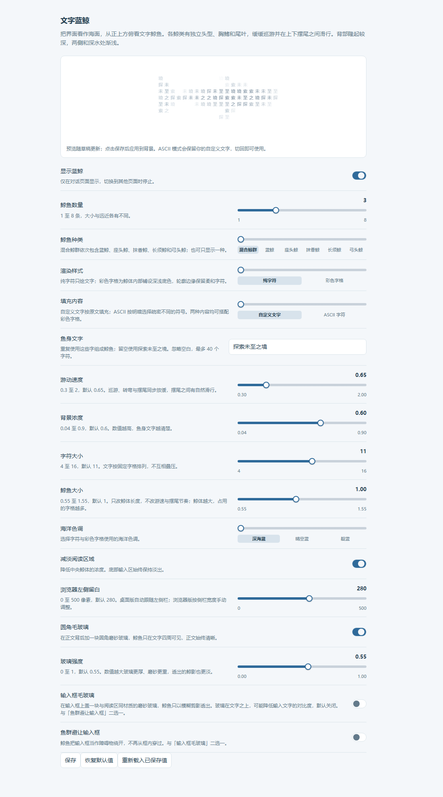
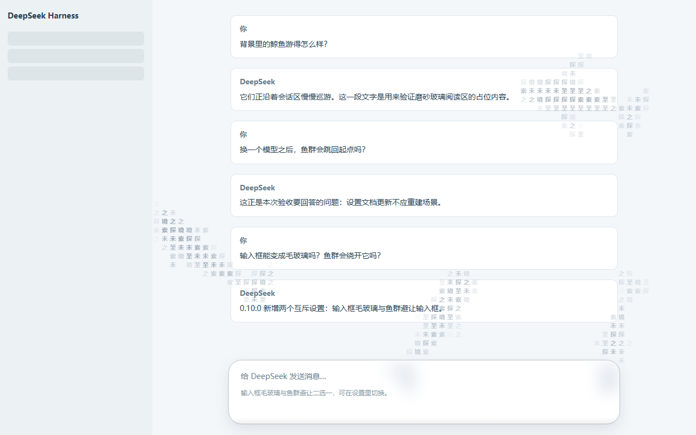

# 文字蓝鲸

DSH 主区域是一片海面，从正上方俯看文字组成的鲸鱼。默认仍使用「探索未至之境」，可在插件设置中换成自己的文字。

## 0.10.0 输入框毛玻璃与鱼群避让

设置页在**玻璃强度**之后新增两个开关，默认都关闭，且**互斥**（开启任意一项会自动关闭另一项；若把两者同时写入配置，插件按「毛玻璃优先」解析）：

| 开关 | 效果 |
| --- | --- |
| **输入框毛玻璃** | 在输入框卡片上盖一块与阅读区同材质的磨砂玻璃：框内鲸鱼只以模糊剪影透出，带描边、顶部微光和底部阴影。 |
| **鱼群避让输入框** | 鲸鱼把输入框当作障碍物绕开，身体不再从框内穿过；关闭后恢复原有巡游。 |

两者互斥的原因是：玻璃已经把框内的鲸鱼藏进磨砂层，再让鱼群绕开同一个位置只会压缩可游动的海面，没有额外视觉收益。毛玻璃需要把文字上方也盖一层材质，会轻微降低输入框文字的对比度，所以默认关闭；材质沿用阅读区那套对比度预算，顶部高光带的强度另外降低（最坏情况仍按 WCAG 计算，明暗两主题、0/0.55/1 三档强度都 ≥ 4.5:1）。

几何来自 DSH 公开的 DOM 钩子：输入框卡片 `[data-composer-card]`，缺失时退回座位 `[data-composer-seat]`；圆角读卡片的实际边框圆角。所有读数只在布局可能变化时进行（400ms 节流，滚动、缩放、开关变化时立即失效），不逐帧查询 DOM。找不到输入框时两个开关自动退化为无操作，不报错。系统开启**减少透明效果**时不绘制玻璃材质，但输入框和阅读区仍然不会出现锐利字符（保持 0.9.0 的可读性行为）。

避让的内部实现是屏幕空间的软障碍：沿鲸体取 5 个轮廓站点（尾鳍、尾柄、中段、胸鳍根、吻端），每个站点带对应部位的半宽；任一站点进入「卡片 + 字格余量」就按最深穿透把整条身体推出去，并让转向提前发生；路线目标若落在障碍内会改到障碍上方最近点。避让开启时，输入框区域本身也不绘制鲸体字形（插件画布位于输入框之上，这是弯尾鳍偶尔扫过时的兜底），所以框内始终是干净的。障碍只影响当前位置与转向，不改变鲸类参数；关闭后与从未开启逐值一致。

## 0.9.0 鲸鱼大小、全滑块设置，以及选中模型不再刷新鱼群

设置页新增 **鲸鱼大小**（0.55 至 1.55，默认 1）。它只改变体长：游速、转向和摆尾节奏仍由鲸类参数决定；鲸体越大占用的字格越多，粒子采样、避让距离和边界回旋随体长联动。默认值 1 与 0.8.0 的画面逐值一致，旧设置不需要迁移。

设置页的选项改为滑块：

| 形态 | 选项 |
| --- | --- |
| 连续滑块 | 数量、游动速度、背景浓度、字符大小、鲸鱼大小、浏览器左侧留白、玻璃强度 |
| 分段滑块 | 鲸鱼种类、渲染样式、填充内容、海洋色调（轨道下方标出各档，可拖、可点、可用方向键） |
| 滑块式开关 | 显示蓝鲸、减淡阅读区域、圆角毛玻璃 |
| 文本框 | 鱼身文字（唯一无法用滑块表达的选项；切到 ASCII 时禁用但保留内容） |

所有数值项都带实时读数与最小/最大刻度，拖动时静态样例立即更新；点击**保存**后才应用到背景。键盘方向键、Home 与 End 沿用浏览器原生滑杆行为。

本版修复了一个此前未被发现的问题：**在输入框切换模型时，背景鱼群会整体跳回初始位置**。根因不在本插件，而在 DSH 的设置同步机制：选择模型会把默认模型写进同一份设置文档，DSH 随后把整份文档重新解码并交给每个配置表单；即使插件自己的设置一个字都没变，表单拿到的也是**内容相同、引用全新**的对象。旧实现按引用判断「配置变了」，于是卸载重挂整层并新建鲸群。

现在改成按值比较：内容没变就完全不动作；真的变了就原地更新——浓度、速度这类选项下一帧生效；只有数量、鱼身文字、鲸类、鲸鱼大小这类结构选项才重建鲸群，并把每条鲸鱼的位置、朝向、游速和摆尾相位迁移过去，不会再跳回起点。换主题、切语言等同样会触发设置文档更新的操作也因此受益。

验证范围见 [SOURCE-NOTES.md](./SOURCE-NOTES.md)。根因来自本机 DSH 安装包解包源码的逐行核对；修复前后各在真实 Chrome 的仿真 shell.overlay 上实测：0.8.0 在一次内容不变的设置文档更新后引擎重挂 1 次、画面指纹精确回到初始布局；0.9.0 同样操作重挂 0 次、画面连续巡游。

## 0.8.0 彩色字格与 ASCII

在插件设置中新增两个独立选项，组合如下：

| 渲染样式 | 填充内容 | 画面 |
| --- | --- | --- |
| 纯字符 | 自定义文字 | 沿用原来的文字鲸鱼，默认组合 |
| 彩色字格 | 自定义文字 | 每格铺深浅底色，继续使用自己的文字 |
| 纯字符 | ASCII | 按明暗选择疏密不同的等宽符号 |
| 彩色字格 | ASCII | 深浅字格加 ASCII 字符，接近参考截图的构成 |

选择 **彩色字格 + ASCII 字符** 即可体验新增效果。底格根据鲸体高度、表面朝向和水深形成色阶，并带少量稳定的冷暖变化；不按时间随机跳色。内部先铺底色再绘字符，边缘覆盖不足处只保留浅字符。前景按实际合成底色选择深浅，淡出的格子不会因为配了白字而丢失字形。

自定义模式保留现有空白处理规则，只使用你的字符。ASCII 使用独立密度串 `.:-=+*ox%#@`，不会改写保存的鱼身文字；切回自定义即可继续使用。字格底色与字符内容互不绑定，旧配置自动保持纯字符、自定义文字。

设置页新增静态鲸鱼样例，草稿改变时立即更新，点击保存后才应用到背景。样例不启动动画循环。五种鲸类、上下摆尾、滑行、玻璃面板及减少动态/透明效果处理继续保留。较小字号能显示更多尾鳍与背部细节。

原版确实先画带色偏的底格，再叠字符；其彩色闪烁主要发生在前景字符，并非随机彩虹底格。具体源码核对和差异见 [ASCII-RENDER-NOTES.md](./ASCII-RENDER-NOTES.md)。本插件使用原创配色与绘制代码。

## 0.7.0 正文背后的圆角毛玻璃

对话区正文后面加了一整块圆角磨砂玻璃：从正文上沿一直贯通到输入框底边，鲸鱼只在玻璃四周和外面游动。玻璃内部是模糊后的鲸影，不再出现和正文抢注意力的单字。

关键约束：鲸鱼画布在 DSH 的浮层里，**位于正文之上**，所以面板里叠的每一层都会直接压低正文对比度。因此鱼影浓度被可读性上限卡住——玻璃的质感主要来自边缘描边、顶部高光、底部阴影和「里面的东西都被模糊了」这件事本身，而不是靠加厚底色。新增检查会用 WCAG 相对亮度公式算出明暗两套主题、0/0.55/1 三档强度下的最坏对比度，低于 7:1（AAA 正文标准）即失败；实测最低 7.41:1。

设置里新增 **圆角毛玻璃**（默认开）与 **玻璃强度**（0 至 1，默认 0.55）。关掉后回到 0.6.0 的纯鱼群背景；系统开启「减少透明效果」时自动放弃玻璃质感，只在正文区清空海水，正文始终优先。

## 0.6.0 鲸类造型与沉稳巡游

新增五套独立体型，可选择混合鲸群或单一鲸类：

| 鲸类 | 俯视轮廓 |
| --- | --- |
| 蓝鲸 | 修长躯干、宽圆吻部、短胸鳍、小而靠后的背鳍 |
| 座头鲸 | 较厚实躯干、约三分之一体长的长胸鳍、宽尾叶 |
| 抹香鲸 | 约三分之一体长的宽钝头部、小胸鳍、低背隆起 |
| 长须鲸 | 更细长的躯干、V 形吻部、较明显的后置背鳍 |
| 弓头鲸 | 圆厚躯干、收窄的吻部、桨状胸鳍、没有背鳍 |

造型对照了 NOAA 的真实航拍照片、Naturalis 物种鉴别资料和原始研究的鲸类俯视照片板。来源与适用范围见 [WHALE-REFERENCES.md](./WHALE-REFERENCES.md)。这是按照片特征绘制的简化模型；未标定的体宽、尾展和各部位站位均为绘制参数。

推进从横向传播波改为尾柄及尾鳍上下摆动。直线巡游不再叠加左右蛇行，转向时仍有带历史位置的身体跟随。头肩保持相对稳定，后躯小幅起伏，两片尾叶同向上下运动。胸鳍缓慢调整角度以配合转向。

巡游基础速度、转弯上限和摆尾节奏均下调。连续摆尾之间平滑过渡到滑行，滑行时仍持续前进。五种鲸类有各自的参数。这些数值用于安静的对话背景，不代表真实物种在统一条件下的实测速度、周期或滑行时间。

## 预览和安装

仓库地址：[github.com/jryang1997/dsh-ascii-whales](https://github.com/jryang1997/dsh-ascii-whales)。安装包也可以从 [Releases](https://github.com/jryang1997/dsh-ascii-whales/releases/latest) 直接下载 `local-dsh-ascii-ocean-0.10.0.tgz`。

打开 [whale-preview.html](./whale-preview.html) 可看四种渲染组合对照，以及可切换鲸类、渲染样式、填充内容、磨砂阅读区和主题的实时预览。预览区底部有一个假输入框，可单独演示**输入框毛玻璃**与**鱼群避让输入框**（两者在预览页同样互斥）。数量、鲸鱼大小和速度是滑杆，暂停冻结最后一帧、恢复后从原地继续；控件变化只调用原地更新，不会重建鱼群。它使用插件的正式渲染器，不需要另起服务器。

包名 `@local/dsh-ascii-ocean`，版本 `0.10.0`，Host 行 id 为 `ascii-whale-background`。使用 DSH 插件管理器安装本目录生成的 `local-dsh-ascii-ocean-0.10.0.tgz`。安装后在插件设置调整滑杆与开关并保存。从 0.9.0 升级只新增两个默认关闭的开关，旧值全部沿用。

## 调整背景

在 **插件 → 文字蓝鲸** 中调整并保存。**鲸鱼种类** 默认混合，依次显示蓝鲸、座头鲸、抹香鲸、长须鲸和弓头鲸；超过五条时重复。原有文字、数量、颜色、浓度和速度设置保持兼容。

**圆角毛玻璃** 默认开启，**玻璃强度** 越高，模糊更重、边缘更清楚，透出的鱼影略淡。两者只影响正文背后那块面板，不改变鲸鱼本身的造型与游动。**输入框毛玻璃** 与 **鱼群避让输入框** 默认关闭、互相排斥，详见 0.10.0 一节。

默认 3 条、字号 11、鲸鱼大小 1、浓度 0.6、速度 0.65。数量 1 至 8，字号 4 至 16，鲸鱼大小 0.55 至 1.55，浓度 0.04 至 0.9，速度 0.3 至 2。字号较大或窗口很小时，短鳍和背鳍可能落不到独立文字格内，这是字格分辨率的限制；鲸鱼大小只改体长，不改游速与摆尾节奏。

**恢复默认值**先修改草稿，再点击**保存**生效。**重新载入已保存值**丢弃未保存的草稿。语言跟随 DSH。支持中文、英文和 emoji；忽略空白，留空使用默认六字。最多 40 个 UTF-16 代码单元，截断保留完整代理对。支持 `Intl.Segmenter` 时保留组合字形。

## 实现与运行范围

[species.js](./species.js) 集中定义五种体型及动作参数。[model.js](./model.js) 构建表面、投影与字格覆盖，并用 `configSignature` 只按取值生成配置指纹；[motion.js](./motion.js) 推进巡游、转向和滑行，提供 `adoptSceneState` 在重建鲸群时迁移运动状态，并用 `setSceneObstacles` 把输入框当作软障碍；[rig.js](./rig.js) 将海面内转向与上下尾拍分别计算，并保持鳍根连接。[shading.js](./shading.js) 处理背部隆起与水深字色；[glass.js](./glass.js) 计算阅读区与输入框两套圆角面板几何及明暗材质；[engine.js](./engine.js) 测量字体、绘制 Canvas，并以 `createWhaleLayer` 提供原地更新；[settings.js](./settings.js) 保存 DSH 原生设置。

相机保持固定正俯视，模型 x 为纵向、y 为水深、z 为横向。隆起处使用深色文字，两侧和深水处较浅。相机保留适度透视，高度会造成轻微径向缩放。

纯字符模式每格只绘一个字符；彩色字格模式在内部先绘带间隙的底格，再绘字符。自定义文字按实际字体测量值保留间距；彩色字格和 ASCII 使用可容纳当前字体的方格。[surface.js](./surface.js) 共享字符选择、色表、字格绘制与静态样例实现。曲面截面规则排列，背鳍在高数量预算下保留中间截面。

`createWhaleLayer` 按 `diffWhaleConfig` 把选项分成六组：数量/文字/鲸类/大小只重建鲸群并迁移运动状态，字号/填充内容/渲染样式重建字体与字格，色调重建配色，阅读区玻璃与输入框选项重测面板/障碍几何，其余项（浓度、速度、减淡、留白、开关）绘制时直接读取。内容完全相同的配置不做任何工作。

模拟以 1/60 秒推进，绘制最多 30fps，DPR 最多 2，画布最多 1200 万像素，表面样本最多 8000。复用投影、字格、脊柱和色表，不逐帧更新 React。没有进行实际 DSH 窗口帧率测量。

隐藏页面暂停；系统减少动态效果时显示静态姿态。离开对话页面或关闭插件时清理 RAF、尺寸观察器及监听器。装饰层不接收点击，中央适度减淡，底部淡出。保留软避让及提前边界回转，软避让不保证鲸体永不交叠。

桌面版跟随 DSH 公开的侧栏宽度和顶部留白。普通浏览器可调整**浏览器左侧留白**。当前接口没有任意右侧面板或弹窗的完整边界信息。

## 截图

| 0.10.0 设置页（全滑块 + 两个新开关） | 输入框毛玻璃 |
| --- | --- |
|  |  |

更多视觉核对图（独立预览页与仿真环境截图，非运行中的 DSH 窗口）：[预览页 · 鲸鱼大小 1.55](./whale-motion.png)、[预览页 · 0.8.0 四组合](./whale-catalog.png)、[预览页 · 0.7.0 对照](./whale-styles.png)、[鲸鱼大小](./whale-size.png)、[彩色字格](./whale-cells.png)、[字格 + 阅读区玻璃](./whale-cells-glass.png)、[鱼群避让输入框](./whale-composer-avoid.png)。

## 构建和检查

```sh
node build.mjs
node preview.mjs
npm run check
npm test
node build.mjs --check
npm pack --ignore-scripts
```

[build.mjs](./build.mjs) 从源码和两种语言字典合成 [client.js](./client.js)。React 由 DSH 提供，Host 使用 `@deepseek-ai/schemastery` 3.18.5，没有安装脚本。

十一组 91 项检查覆盖原有鲸类、动作、字格和玻璃，以及四种渲染组合、配置兼容、自定义文字保留、ASCII 密度、色表、轮廓覆盖、前景对比与分数 DPR；`update.test.js` 覆盖配置指纹、六组重建分类、鲸鱼大小的预算与体长、运动状态迁移，以及「内容相同的设置快照必须是完全 no-op」；`composer.test.js` 覆盖输入框面板几何与裁切、输入框玻璃的对比度预算、互斥归一化，以及避让的身体级不变量（三档体型的静态帧与 60 秒仿真中，所有身体站点都在卡片余量之外；关闭避让的对照会明显穿框）。隔离的真实 Chrome 另外验证重挂次数与画面连续性、滑杆键盘操作、保存与重新载入、输入框毛玻璃与避让、预览页三档体长、明暗主题、磨砂阅读区、暂停恢复、减少动态/透明效果与窄窗口。历次根因和验证边界见 [SOURCE-NOTES.md](./SOURCE-NOTES.md)。浏览器测试使用独立预览及设置仿真环境，当前运行 DSH 的安装和最终叠层观感尚未核对。


鲸体、代码及 [图标](./icon.svg) 为本插件原创。算法思路参考 [ascii-sharks](https://github.com/stackedlol/ascii-sharks)，未复制其源码或素材。真实参考照片保留在本地研究目录，与 `.scratch/` 验证证据、第三方参考仓库 `ascii-sharks-reference/` 一同不随仓库发布（见 [.gitignore](./.gitignore)）。


