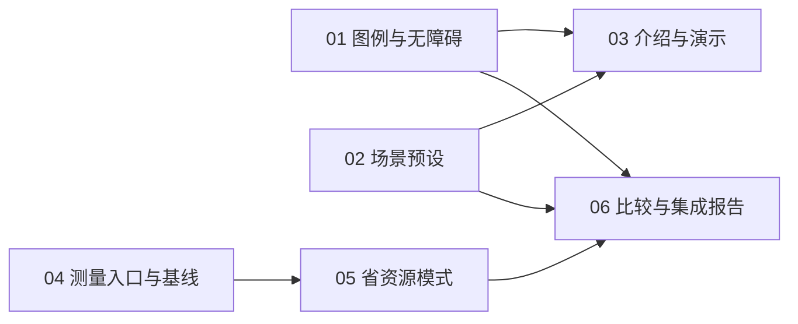

# 文字蓝鲸改进任务拆分与发布记录

状态：用户已确认六票拆分并明确授权发布 GitHub。六张 Issue 均已创建并标记 ready-for-agent，原生阻塞关系已逐票读取核对。未开始产品实现。

来源为[文字蓝鲸改进规格草案](./whale-experience-and-resource-mode.zh.md)。本文件是审阅与发布索引，任务正文各自独立。01 至 06 是本地任务编号，对应的实际 GitHub Issue 见发布表。

## 逐票交付与直接阻塞

1. [01：任务状态图例与等价无障碍提示](../../.scratch/whale-improvements/issues/01-activity-legend-accessibility.md)。无阻塞。交付首次图例、可查询状态、重要转换播报、能力缺失降级及实际读屏验证。
2. [02：场景预设与配置草稿保留](../../.scratch/whale-improvements/issues/02-scene-presets.md)。无阻塞。交付四场景、草稿预览与保存、高级设置收敛以及配置保留。
3. [03：任务价值介绍与真实状态演示](../../.scratch/whale-improvements/issues/03-task-introduction-demo.md)。阻塞于 01、02。交付对应实际交互的中英文介绍、真实录屏、静态图例与第一组集成验收。文案可先准备，完成验收等待交互。
4. [04：可复现测量入口与标准档基线](../../.scratch/whale-improvements/issues/04-resource-baseline.md)。无阻塞。交付可运行的关闭与标准两条件基线、真实工作计数、原始结果及复跑方式，不伪造未来省资源结果。
5. [05：可切换的省资源模式与真实暂停](../../.scratch/whale-improvements/issues/05-resource-mode.md)。阻塞于 04。交付可保存的资源选择、低频慢漂移、真实暂停及实际工作减少证明。完整场景和等价文本组合验收由 06 负责。
6. [06：三条件资源比较与跨功能验收报告](../../.scratch/whale-improvements/issues/06-resource-comparison-report.md)。阻塞于 01、02、05。交付关闭、标准、省资源完整比较，场景与状态组合验收，以及中英文资源报告。04 是传递依赖，不重复列边。

第一组为 01、02、03，第二组为 04、05、06。第二组按产品优先级后置，04 可提前准备工具和基线。图中无阻塞不等于已批准实施。

## 依赖为何存在

03 的最终素材和第一组验收需要 01、02 的真实交互。05 必须能用 04 的有效计数与基线证明实际减少工作，低帧率外观本身不足以交付。06 需要两组交互才能完成文本、Canvas、预设和资源档位的组合验收。

05 不重复实现 01 的摘要或 02 的预设，因此不把它们列为前置。其独立档位选择、渲染与暂停先验收，组合部分明确交给 06。06 不等 03 的录屏，第一组也不等待性能报告。

## 验收覆盖与责任

每条规格验收有一个最终负责票。其他票的部分证据作为输入，不替代最终验收。共 22 条全部映射。

| 规格验收 | 最终负责票 | 配合证据 |
| --- | --- | --- |
| G1-01 | 01 | 首次图例与重开 |
| G1-02 | 01 | 状态语义及分来源降级 |
| G1-03 | 01 | 历史、重复和会话切换 |
| G1-04 | 01 | 任务汇总与文本一致 |
| G1-05 | 01 | 键盘及实际读屏 |
| G1-06 | 01 | 联动关闭与释放 |
| G1-07 | 02 | 四场景及保护项 |
| G1-08 | 02 | 自定义匹配与重置 |
| G1-09 | 02 | 草稿及保存协议 |
| G1-10 | 03 | 01、02 的兼容与语言证据，加第一组组合回归 |
| G1-11 | 03 | 介绍与真实演示 |
| G1-12 | 03 | 01、02 构建及真实交互证据，加第一组集成验证 |
| G2-01 | 06 | 02、05 的配置规则，加跨场景档位验证 |
| G2-02 | 05 | 04 提供真实工作计数及基线 |
| G2-03 | 05 | 01 的既有状态契约，06 复验组合接续 |
| G2-04 | 06 | 01 文本、05 绘制，加双终点集成计时 |
| G2-05 | 05 | 06 复验集成暂停与清理 |
| G2-06 | 06 | 05 模式视觉与保护证据，加场景组合回归 |
| G2-07 | 06 | 04 提供入口与旧基线，最终构建重新取得三条件数据 |
| G2-08 | 06 | 05 证明实际工作减少，加重复资源比较 |
| G2-09 | 06 | 04 可复跑数据格式，加实际三条件及公开文案 |
| G2-10 | 06 | 04、05 增量验证，加第二组完整验证 |

## 起步条件与协作边界

- 六票均已获用户确认并发布，带 ready-for-agent 标签。标签表示规格可供执行，不能越过原生阻塞关系，也不表示已经验收或开始实现。
- 场景数值、15 次每秒持续绘制、0.75 倍漂移及 250 毫秒响应沿用本轮确认的规格预算，不描述为实测结果。
- 实施前重新核对完整工作区与提交基线。现有未提交修改不能在 worktree 中被遗漏，不自动提交、重置或覆盖用户工作。
- 不预先新增抽象层或纯基础设施票。状态文本、测试适配器、测量计数均随对应可验收切片交付。
- 并行实施使用隔离工作区。设置、中英文文案或介绍材料存在共享修改时，协调合并并复核，不以覆盖文件解决冲突，不为共享文件制造虚假功能依赖。
- 第一组的设置和图例组合入口在 03 验收，第二组资源入口在 06 验收。01、02 独立完成时不要求实现对方功能。
- 04 基线只能代表其测量构建。06 在最终集成构建重测三条件，不直接拿旧标准档与新省资源档计算收益。
- 各票附带行为测试、构建与匹配表面的真实证据，测试运行耗时不代替资源测量。读屏和 GPU 缺少真实证据时明确未测。

## GitHub 发布与核对

用户在本轮原生确认中选择“按此拆分并发布 GitHub”。已按依赖顺序创建六票并设置 ready-for-agent，使用 GitHub 原生 blocking。没有修改或关闭任何既有父任务，也没有虚构父 Issue。

| 本地任务 | 实际 Issue | 原生 blocked by |
| --- | --- | --- |
| 01 | [#1 任务状态图例与等价无障碍提示](https://github.com/jryang1997/dsh-ascii-whales/issues/1) | 无 |
| 02 | [#2 场景预设与配置草稿保留](https://github.com/jryang1997/dsh-ascii-whales/issues/2) | 无 |
| 03 | [#3 任务价值介绍与真实状态演示](https://github.com/jryang1997/dsh-ascii-whales/issues/3) | #1、#2 |
| 04 | [#4 可复现测量入口与标准档基线](https://github.com/jryang1997/dsh-ascii-whales/issues/4) | 无 |
| 05 | [#5 可切换的省资源模式与真实暂停](https://github.com/jryang1997/dsh-ascii-whales/issues/5) | #4 |
| 06 | [#6 三条件资源比较与跨功能验收报告](https://github.com/jryang1997/dsh-ascii-whales/issues/6) | #1、#2、#5 |

已逐票读取原生依赖，结果分别为 []、[]、[1,2]、[]、[4]、[1,2,5]，与批准的图一致。发布前已检查目标仓库和现有开放任务，没有复用或覆盖未知任务。

本地六份正文已回填实际链接并标记拆分已确认。未勾选任何功能验收项。本轮只发布任务及标签、设置阻塞关系、保存本地记录，没有开始实现、修改插件配置、提交或推送产品改动。
